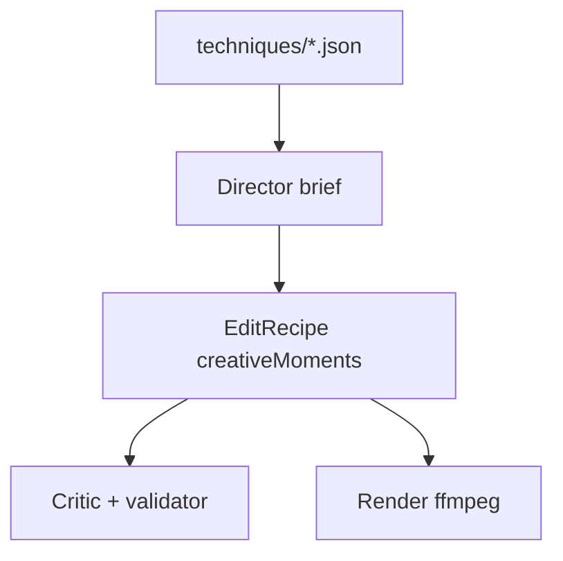

# EditRecipe v2.1 — Rejestr zabiegów montażowych (Creativity Layer)

> Status: plan do realizacji  
> Ostatnia aktualizacja: 2026-06-26  
> Zależności: EditRecipe v2.0 (zaimplementowany), spatial index i render — fazy późniejsze

## Problem i cel

Reżyser AI ma dziś swobodę opisową (`videoTransform`, cięcia słowne), ale brakuje **strukturalnego dostępu do popularnych zabiegów montażowych** stosowanych na YouTube (zoom punch-in, cięcie w połowie zdania, jump cut, whip pan, Ken Burns na B-roll itd.).

**Cel:** system **gramatyki montażu w danych** — katalog technik + momenty w `EditRecipe` + profil kreatywności + walidacja budżetu — **łatwo rozszerzalny** o nowe trendy bez przepisywania core pipeline.

**Done looks like:**
- Katalog JSON w `techniques/` z ~15 zabiegami startowymi + JSON Schema
- Loader Node: `loadTechniqueCatalog({ pack, platforms })`
- Rozszerzenie schematu `EditRecipe` v2.1: `creativityProfile`, `creativeMoments[]`
- Director + Critic prompty v2.1 z katalogiem i regułami gating
- Walidator: budżet technik, `cut_mid_sentence` tylko przy `allowMidSentenceCuts`
- Testy jednostkowe loadera, walidatora, budżetu
- Dokumentacja w README (sekcja v2.1)

---

## Architektura (3 warstwy)

```
techniques/*.json     →  co MOŻNA zrobić (definicje, parametry, constraints)
Director brief        →  katalog + budżet + (opcjonalnie spatial)
EditRecipe            →  creativeMoments[] — co ZROBIONO
Critic / validator    →  budżet, reguły, confidence
Render (przyszłość)   →  mapowanie techniqueId → ffmpeg
```



---

## Struktura katalogu

```
techniques/
  _schema.json              # JSON Schema pojedynczego zabiegu
  catalog.meta.json         # wersja katalogu, lista plików, domyślny pack
  camera/
    zoom_punch_in.json
    zoom_punch_out.json
    zoom_slow_push.json
    snap_zoom.json
    ken_burns_light.json
    reframe_follow_subject.json
  edit/
    cut_on_beat.json
    cut_mid_sentence.json
    jump_cut.json
    match_cut.json
    hard_cut_energy.json
  transition/
    crossfade.json
    dip_to_black.json
    whip_pan.json
    j_cut.json
    l_cut.json
  audio/
    music_swell.json
    music_drop.json
    silence_beat.json
  packs/
    youtube_vlog_2026.json    # bundle: enabled ids + nadpisane defaults
    shorts_energy.json
```

---

## Schemat pojedynczego zabiegu

```json
{
  "id": "zoom_punch_in",
  "version": "1.0",
  "category": "camera",
  "label": "Punch-in zoom",
  "description": "Krótkie zbliżenie na twarz lub temat w momencie akcentu.",
  "platforms": ["youtube", "shorts"],
  "trendTags": ["talking_head", "classic_youtube"],
  "params": {
    "factor": { "type": "number", "min": 1.05, "max": 1.25, "default": 1.08 },
    "durationSec": { "type": "number", "min": 0.5, "max": 4, "default": 2.5 },
    "anchor": { "type": "enum", "values": ["face", "subject", "center"], "default": "face" },
    "easeSec": { "type": "number", "default": 0.4 }
  },
  "constraints": {
    "minGapFromSameTechniqueSec": 45,
    "maxPerOutputMinutes": 0.15,
    "requiresSpatialAnchor": true,
    "forbiddenOnSegmentRole": ["broll"],
    "requiresCreativityLevel": null
  },
  "whenToUse": "Punchline, ważne zdanie, emocja.",
  "whenToAvoid": "Słabe światło, shakecam, zoom w ostatnich 30 s.",
  "syncHints": ["sentence_start", "word_emphasis", "beat_after_pause"]
}
```

Pola opcjonalne dla gatingu:
- `constraints.requiresCreativityLevel`: `"bold"` | `"shorts"` — np. dla `cut_mid_sentence`
- `constraints.allowMidSentenceCuts`: wymaga `creativityProfile.allowMidSentenceCuts === true`

---

## Katalog startowy (~15 zabiegów MVP+)

### camera
| id | Opis |
|----|------|
| `zoom_punch_in` | Zbliżenie 5–15% na akcent |
| `zoom_punch_out` | Oddalenie — koniec myśli |
| `zoom_slow_push` | Wolny push-in przed reveal |
| `snap_zoom` | Szybki zoom (shorts) |
| `ken_burns_light` | Lekki ruch na statycznym B-roll |
| `reframe_follow_subject` | Kadrowanie na twarz/obiekt (9:16) |

### edit
| id | Opis |
|----|------|
| `cut_on_beat` | Cięcie na pauzie / końcu frazy |
| `cut_mid_sentence` | Cięcie w połowie zdania (gated) |
| `jump_cut` | Skok w tej samej scenie |
| `match_cut` | Dopasowanie ruchu/kompozycji |
| `hard_cut_energy` | Ostre cięcie bez dissolve |

### transition
| id | Opis |
|----|------|
| `crossfade` | 0.3–0.8 s |
| `dip_to_black` | Rozdział |
| `whip_pan` | Dynamiczne shorts |
| `j_cut` | Audio z poprzedniego pod B-roll |
| `l_cut` | Wideo z następnego pod audio |

### audio (deferred render, schema ready)
| id | Opis |
|----|------|
| `music_swell` | Podbicie muzyki |
| `music_drop` | Ciszej pod kwestią |
| `silence_beat` | Krótka pauza dramatyczna |

---

## creativityProfile

```json
{
  "creativityProfile": {
    "level": "safe | balanced | bold | shorts",
    "allowMidSentenceCuts": false,
    "techniquePack": "youtube_vlog_2026",
    "maxTechniqueDensityPerMin": 0.3
  }
}
```

| level | Zachowanie |
|-------|------------|
| `safe` | `cut_on_beat`, `crossfade`; max ~1 zoom / 10 min |
| `balanced` | Domyślne; punch-in przy akcentach; bez mid-sentence |
| `bold` | Mid-sentence cuts, więcej zoomów, krótsze segmenty |
| `shorts` | `snap_zoom`, szybkie cięcia, gęstość x2 |

Parsowanie z `--context`: `creativity: bold`, `shorts: energy high`.

Domyślne budżety — port logiki z `video-modifier/lib/visual-edit-tuning.js`:
- max zoomów ~1 na 6 min, min gap, max duty ~1.8% czasu trwania

---

## creativeMoments w EditRecipe

```json
{
  "creativeMoments": [
    {
      "momentId": "cm_001",
      "techniqueId": "zoom_punch_in",
      "outputId": "youtube_16x9",
      "outputStartSec": 42.0,
      "outputEndSec": 44.5,
      "params": { "factor": 1.12, "anchor": "face" },
      "anchorWordId": "clip01_w0042",
      "segmentId": "seg_003",
      "spatialRef": {
        "clipId": "clip01",
        "sceneId": "clip01_scene003",
        "timestampSec": 41.8
      },
      "reason": "Punchline po setupie",
      "confidence": 0.85
    }
  ]
}
```

**Rozdzielenie:**
- `timeline[]` — co z którego klipu (A/V refs)
- `creativeMoments[]` — jak obróbka wizualna/rytmiczna

Pola opcjonalne: `spatialRef` (gdy brak spatial index — `confidence` max 0.6, flaga `needsSpatialReview` w critic).

---

## Pliki do utworzenia / zmiany

| Plik | Akcja |
|------|-------|
| `techniques/**` | Nowy katalog JSON |
| `src/editorial/load-technique-catalog.js` | Loader + pack filter |
| `src/editorial/technique-budget.js` | Budżet z duration + level |
| `src/editorial/format-catalog-for-prompt.js` | Skrócona tabela do LLM |
| `src/schemas/edit-recipe-v2.js` | `CreativityProfileSchema`, `CreativeMomentSchema` |
| `src/validators/recipe-v2.js` | V21-* reguły budżetu |
| `src/validators/creative-moments.js` | Walidacja momentów vs katalog |
| `src/agents/director.js` | Inject catalog + creativityProfile |
| `src/agents/critic.js` | Sprawdzenie momentów |
| `prompts/v2/director.md` | Sekcja creative techniques |
| `prompts/v2/critic.md` | Kody V21-* |
| `tests/editorial/*.test.js` | Loader, budget, validator |
| `docs/EDITING_RECIPE_V2_SPEC.md` | Sekcja v2.1 (lub osobny spec) |
| `README.md` | Krótka sekcja v2.1 |

---

## Walidacja (nowe kody)

| Kod | Reguła |
|-----|--------|
| V21-01 | `techniqueId` musi istnieć w załadowanym katalogu |
| V21-02 | `params` w zakresach z definicji zabiegu |
| V21-03 | `cut_mid_sentence` tylko gdy `allowMidSentenceCuts` |
| V21-04 | Min gap między tym samym `techniqueId` |
| V21-05 | `maxPerOutputMinutes` / density z katalogu + budget |
| V21-06 | `forbiddenOnSegmentRole` — np. zoom na broll gdy zabronione |
| V21-07 | `requiresSpatialAnchor` — wymaga `spatialRef` lub anchor word w segmencie A-roll |
| V21-08 | Każdy moment ma niepusty `reason` |

---

## Integracja z pipeline

1. **clip_profile / topic_index** — bez zmian
2. **direct** — przed LLM: `loadTechniqueCatalog`, `computeCreativityBudget`, `formatCatalogForPrompt`
3. **review** — critic + `validateCreativeMoments(recipe, catalog, budget)`
4. **Spatial index** — **poza scope tej fazy**; schema gotowa na `spatialRef`

---

## Rozszerzalność

1. Nowy trend = nowy plik `techniques/<category>/<id>.json`
2. Nowy pack = `techniques/packs/<name>.json` z listą `enabledTechniqueIds`
3. `catalog.meta.json` — semver katalogu; test CI waliduje wszystkie pliki vs `_schema.json`
4. Director prompt **nie** hardcoduje listy — tylko injected catalog

---

## Poza scope v2.1 (kolejne fazy)

- `05c-spatial-index.json` (twarze + Florence bbox)
- Render ffmpeg mapujący `techniqueId` → filtry
- `audioPolicy: external` + pełny `audioMix` (LUFS, ducking)
- `segmentRole: transition | bridge`

---

## Test plan

```bash
npm test
```

- Loader: unknown pack → fallback default
- Budget: 15 min balanced → max zoom count zgodny z tuning
- Validator: `cut_mid_sentence` odrzucone przy `safe`
- Validator: params poza min/max → V21-02
- Schema: export JSON schema includes creativeMoments

---

## Kolejność implementacji

1. `techniques/_schema.json` + pliki zabiegów + `catalog.meta.json`
2. `load-technique-catalog.js` + testy
3. `technique-budget.js` (port z visual-edit-tuning) + testy
4. Rozszerzenie Zod schema + export
5. `validate-creative-moments.js` + testy
6. Director/critic prompt + agent wiring
7. README + aktualizacja handoff `~/.cursor/work/video-editing-agent.md`
