# Plan: Retencja, narracja i sztuka montażu internetowego

> Last updated: 2026-07-03  
> Status: plan (analiza zakończona, implementacja nie rozpoczęta)  
> Powiązane audyty: [`RETENTION_ENGAGEMENT_AUDIT_2026-06-28.md`](./RETENTION_ENGAGEMENT_AUDIT_2026-06-28.md), [`W4_19_PLAN.md`](./W4_19_PLAN.md), [`REQUIREMENTS_SFX_LIBRARY_AND_VOICEOVER.md`](./REQUIREMENTS_SFX_LIBRARY_AND_VOICEOVER.md), [`RENDER_MODULE_SPEC.md`](./RENDER_MODULE_SPEC.md), [`FORMATY_AI_I_GOTOWOSC_MONTAZU.md`](./FORMATY_AI_I_GOTOWOSC_MONTAZU.md)

## Cel dokumentu

Zebranie **wszystkich obserwacji** z głębokiej analizy pipeline’u (director, enrichery, walidatory, renderer, techniki, abstrakcja L1/L2/L3, super-reżyser) pod kątem:

- co **wzmacnia oglądalność** na YouTube / shortach,
- co **chroni opowiadaną historię**,
- gdzie system **obiecuje więcej niż render dostarcza**,
- co **reżyser powinien móc robić**, a czego jeszcze brakuje.

Dokument jest planem implementacyjnym — nie zastępuje specyfikacji EditRecipe v2 ani `RENDER_MODULE_SPEC.md`.

---

## Streszczenie wykonawcze

| Obszar | Ocena | Główny wniosek |
|--------|-------|----------------|
| **Vlog main 16:9** | ~92% gotowości | Retencja + enrich + walidacja V22-VLOG działają; ryzyko **przesadnej gęstości beatów** |
| **Shorty 9:16** | ~75% gotowości | Surowe V22 **bez deterministycznego enrich** — jakość zależy od LLM |
| **Narracja długiego formu** | ~60% | L3 daje tekst (`narrativeArc`), brak **strukturalnych guardrails** (payoff, oddech, callback) |
| **Semantyka technik** | ~70% | Katalog obiecuje montaż profesjonalny; renderer często robi **aproksymacje FFmpeg** |
| **Pipeline VO / pionowe wstawki** | ~85% | Zaimplementowane 2026-07-03 (`fitMode`, MP3/WAV, pillarbox) — patrz §Już zrobione |

**Największy ROI bez zabijania historii:** enrich shortów + cięcie dead air w timeline + `narrativeProfile` z hamulcami na beaty/SFX + uczciwość promptów wobec renderera.

**Największy ROI wizualny (render):** blur pillarbox, per-segment ducking, lepsze przejścia, frame-accurate J/L i B-roll sync.

---

## Już zrobione (sesja 2026-07-03, commity `9e47d79`, `08092c6`)

Te elementy **nie są** w scope tego planu jako „do zrobienia”, ale wpływają na kontekst reżysera:

| Funkcja | Opis |
|---------|------|
| **Speed / volume** | `videoTransform.speed`, `speedMode`, `sourceVolumeDb`; renderer `atempo`+`setpts` |
| **Super Director** | Router L2 → segment directors → merge; próg `>600s` lub `L2 > 1` |
| **TwelveLabs scaffold** | Krok `twelvelabs` (stub); merge w topic-index |
| **Pionowe wstawki 9:16 → 16:9** | `fitMode: pillarbox` \| `fill`; pillarbox domyślnie (czarne pasy) |
| **Częściowy VO** | MP3/WAV/M4A ingest, `narration_track`, mix A-roll + `from_audio_ref` |
| **Pipeline fixes** | `mediaType` po scene-detect; skip keyframes dla `audio_only` |

---

## Architektura obecnego stacku retencji

```mermaid
flowchart LR
  subgraph brief [Brief reżysera]
    TRP[shortsRetentionProfile / vlogRetentionProfile]
    RBT[retentionBeatTargets / anchors]
    CCH[chapterCardHints / narrativeOpenLoops]
    AI[audioIndex: deadAir / beats / peaks]
  end
  subgraph recipe [EditRecipe v2.4]
    CM[creativeMoments]
    TO[textOverlays]
    TL[timeline + cuts]
    AMP[audioMixPlan / sfxPlan]
  end
  subgraph enforce [Walidacja]
    V21[V21 creative budget]
    V22[V22 shorts / V22-VLOG]
    V24[V24 pacing + SFX density]
    V25[V25 B-roll / chronology / VO / AR]
  end
  subgraph enrich [Enrichery post-director]
    ERB[enrichRecipeRetentionBeats — tylko vlog main]
    ECC[enrichRecipeChapterCards]
    ECO[enrichRecipeColdOpenSegment]
    ESD[enrichRecipeSilenceBeatFromDeadAir]
    ESFX[enrichRecipeSfxPlan]
    EBR[enrichBrollSyncFromHints]
  end
  brief --> recipe
  recipe --> enforce
  recipe --> enrich
  enrich --> render[FFmpeg: segment / concat / creative / graphics / audio-mix]
```



**Zasada enrichera (kontrakt w `prompts/v2/director.md`):** reżyser jest autorem głównym; enrich **uzupełnia luki**, nie zastępuje dyrektywy.

---

## Katalog technik (26 technik, 3 packi)

**Rejestr:** `techniques/catalog.meta.json`

| Kategoria | Techniki |
|-----------|----------|
| **camera** | `zoom_punch_in`, `zoom_punch_out`, `zoom_slow_push`, `snap_zoom`, `ken_burns_light`, `reframe_follow_subject` |
| **edit** | `cut_on_beat`, `cut_mid_sentence`, `jump_cut`, `match_cut`, `hard_cut_energy` |
| **transition** | `crossfade`, `dip_to_black`, `whip_pan`, `j_cut`, `l_cut` |
| **audio** | `music_swell`, `music_drop`, `silence_beat`, `voice_pitch_shift` |
| **graphics** | `hook_title_overlay`, `hook_visual_punch`, `emphasis_text`, `chapter_card`, `pattern_interrupt`, `retention_beat` |

### Packi

| Pack | Plik | Rola |
|------|------|------|
| `youtube_vlog_2026` | `techniques/packs/youtube_vlog_2026.json` | Main 16:9 — zoomy, przejścia, audio; **bez** graphics retention |
| `shorts_retention_2026` | `techniques/packs/shorts_retention_2026.json` | Gramatyka shortów — hooki, beaty, graphics, agresywne cięcia |
| `shorts_energy` | `techniques/packs/shorts_energy.json` | Gęsty 9:16 **bez** packa graphics retention |

### Domyślna rotacja beatów

Źródło: `src/editorial/shorts-retention.js`

- **Shorts:** `pattern_interrupt` → `retention_beat` → `snap_zoom` → `jump_cut` (co ~25s ±5s)
- **Vlog:** `zoom_slow_push` → `ken_burns_light` → `music_swell` → `silence_beat` (co ~45s ±8s)

### Auto-włączanie profili retencji

- **Shorts retention:** gdy `9:16` w `requiredFormats`, `creativityProfile.level === "shorts"`, lub `userContext` zawiera `shorts: retention`
- **Vlog retention:** gdy istnieje output main `16:9`
- Shorts retention **nie** włącza się przy domyślnym `16:9,9:16` bez opt-in
- Wyłączenie: `shortsRetentionProfile.enabled: false` / `vlogRetentionProfile.enabled: false`

---

## Co reżyser dostaje w briefie

**Pliki:** `src/agents/director.js`, `prompts/v2/director.md` (~560 linii), `prompts/v2/critic.md`

| Pole briefu | Funkcja |
|-------------|---------|
| `shortsRetentionProfile`, `vlogRetentionProfile` | Profile retencji per format |
| `retentionGrammarSummary` | Skrót reguł dla LLM |
| `retentionBeatTargets` (+ `_Main` / `_Short`) | Docelowe beaty na osi czasu |
| `retentionTechniqueRotation` | Rotacja technik na beatach |
| `retentionBeatAnchors` | Kotwice z energy peaks + L1 keyMoments |
| `chapterCardHints` | Propozycje chapter cards z L2 |
| `narrativeOpenLoops` | Cold open / payoff tease (max 2 hinty tekstowe) |
| `coldOpenSegmentHint` | Tease + rewind |
| `techniqueCatalog`, `creativityBudget` | Dozwolone techniki i limity |
| `audioIndex`, `deadAirHints`, `sfxPlanDefaults` | Audio-driven editing |
| `hasSeparateNarration` | Flaga z L3 (od 2026-07-03) |
| `aspectMix`, `clipAspectById` | Orientacja klipów (pillarbox / fill) |

### Gramatyka shortów (prompt §305–329)

| Element | Reguła |
|---------|--------|
| Hook | 0–3s, niechronologiczny, text + visual punch |
| Beaty | Co ~25s, `retentionRole: beat` |
| Overlaye | Max 1 duży hook / 15s |
| Pack | `shorts_retention_2026` |

### Gramatyka vloga (prompt §331–374)

| Element | Reguła |
|---------|--------|
| Beaty | Co ~45s, subtelna rotacja |
| Unikać na beatach main | `jump_cut`, `hard_cut_energy`, `pattern_interrupt`, `snap_zoom` |
| Payoff | `retentionRole: payoff` tylko przy kulminacji L2/L3 |
| Chapter cards | ~3–5 min, `textOverlays` style `chapter_card` |
| Cold open | Tease payoff → rewind do chronologii |

---

## Shorts vs main vlog — asymetria (kluczowa obserwacja)

| Capability | Short (`outputKind: short`) | Main vlog (`outputKind: main`) |
|------------|----------------------------|--------------------------------|
| Hook 0–3s | Wymagany (V22-01/02) | Opcjonalny; cold open via `narrativeOpenLoops` |
| Kadencja beatów | ~25s, agresywna rotacja | ~45s, subtelna rotacja |
| **Deterministyczny enrich beatów** | **Brak** | `enrichRecipeRetentionBeats` |
| Chapter cards | `chapter_card` technique = short-only w packu | `textOverlays` + enrich |
| Muzyka bed | Opcjonalna | Silna ścieżka `audioMixPlan` + swell/drop |
| Dead air | Prompt: `cuts.wordIds` | `deadAirHints` + enrich `silence_beat` (dip, nie cut) |
| Guard pacing | Brak V24-05 | V24-05 vs source / L3 `estimatedKeepRatio` |
| Graphics pack | `shorts_retention_2026` | `youtube_vlog_2026` (bez hook graphics w packu) |
| Render clamp hook | `enrichRenderEdl` clamp do okna hook | N/A |

**Wniosek:** Vlog ma **produkcyjną poduszkę enrich**; shorty są **w pełni zależne od LLM** przy surowych regułach V22.

---

## Super-reżyser a narracja długiego formu

**Pliki:** `src/agents/super-director.js`, `src/lib/segment-catalog.js`, `src/lib/recipe-merge.js`

| Ścieżka | Flow | Implikacja narracyjna |
|---------|------|------------------------|
| Legacy | `runDirector` → `directorDrillDown` | Pełny L0/L1 na scenach z receptury |
| Super | `runSuperDirector` → N× `runSegmentDirector` → merge | Super widzi **tylko karty L2**; segment directors bez globalnego drill-down |

**Obserwacja:** Długi form dostaje **więcej scaffoldingu retencji, mniej refinacji scenowej** — odwrotnie do potrzeb filmu opowieściowego.

`crossSegmentNotes` w planie super-reżysera to **wolny tekst** — brak struktury callback / open loop.

---

## Abstrakcja L1/L2/L3 i pętle narracyjne

| Warstwa | Narracja | Retencja |
|---------|----------|----------|
| **L1** | `summary`, `mood`, `keyMoments` | `brollPotential`, `topics` → B-roll + beat anchoring |
| **L2** | Segment `summary` (~5–15 min) | Chunking dla super-reżysera |
| **L3** | `narrativeArc`, `sessionSummary`, `estimatedKeepRatio` | `formatFit`, `recommendedFormats`, V24-05 |

**`buildNarrativeOpenLoops()`** (`src/editorial/chapter-hints.js`):

- Max **2** hinty tekstowe: `cold_open`, `payoff_tease`
- Brak grafu open loop (setup time, payoff scene, mid-video loops)
- `narrativeRole` w `segment-catalog.js` **nie** w schemacie `AbstractionBundle`

**`collectRetentionAnchorCandidates`** (`shorts-retention.js`): kotwice z energy peaks + L1 keyMoments — dobre na **punch**, słabe na **wolne/emocjonalne** sekcje.

---

## Enrichery — pełna lista

Post-director (`applyDeterministicRecipeEnrichers` w `src/pipeline/steps/agents.js`):

| Enricher | Plik / moduł | Co uzupełnia | Scope output |
|----------|--------------|--------------|--------------|
| `enrichRecipeRetentionBeats` | `shorts-retention.js` | `enrich_beat_*` gdy brak beatów | **Tylko vlog main** |
| `enrichRecipeSilenceBeatFromDeadAir` | `dead-air-enrich.js` | `silence_beat` przy dead air `source: "both"` | Main |
| `enrichRecipeSfxPlan` | `sfx-plan.js` | SFX z `audioEvents` | Wszystkie outputy |
| `enrichRecipeChapterCards` | `chapter-hints.js` | Overlays chapter z L2 | Main ≥180s |
| `enrichRecipeColdOpenSegment` | `chapter-hints.js` | Prepend tease (rewind niekompletny — W4.19-1) | Main |
| `enrichBrollSyncFromHints` | `broll-sync-hints.js` | `videoInSec` B-roll | Per segment |

Render-time (`src/render/enrich-render-edl.js`):

| Enricher | Funkcja |
|----------|---------|
| `projectHookTitleOverlays` | `hook_title_overlay` → `textOverlays` |
| `projectPatternInterruptTextOverlays` | `pattern_interrupt` cut_text → overlay |
| `attachSpatialRef` | Bbox dla 9:16 / face reframe |
| `clampCreativeMomentsToHookWindow` | Hook shortów w pierwszych 3s |

**Filozofia obecna:** enrichery **dodają retencję**, rzadko **ograniczają**.

---

## Walidatory — mapa V21–V25 (retencja-relevant)

| Warstwa | Plik | Kody / rola |
|---------|------|-------------|
| **V21** | `src/validators/creative-moments.js` | Katalog, budżet, spatial, `music_swell`→bed (V21-12), `silence_beat`→cisza (V21-13), `j_cut`/`l_cut` zakaz w creativeMoments (V21-14) |
| **V22** | `src/validators/shorts-retention.js` | Hook window, min beaty, max luki, graphics short-only |
| **V22-VLOG** | `src/validators/vlog-retention.js` | Min beaty main, agresywne techniki (warning), monotonia rotacji, drift od targetów |
| **V23** | `recipe-v2.js` | LUFS, music bed catalog |
| **V24** | `recipe-v2.js` | V24-06 SFX density (~1/90s main); **V24-05** pacing main vs source/L3 |
| **V25** | `broll-*.js`, `chronology.js`, `aspect-ratio.js`, VO | B-roll sync/strategy; V25-CHR-03 cold open bez rewind; V25-VO; V25-AR |

### Czego walidatory **nie** sprawdzają dziś

- Chapter cards gdy `chapterCardHints` istnieją
- `retentionRole: payoff` przy kulminacji narracji
- Dead air faktycznie usunięty z timeline (tylko dip audio)
- Payoff po cold open / tease
- Callback wizualny między segmentami
- Limit `pattern_interrupt` na main (tylko warning V22-VLOG-03 na beatach)

---

## Renderer — passy i mapowanie technik

**Passy** (`src/render/execute-render.js`):

1. Segments — `ffmpeg-segment.js`, `ffmpeg-reframe.js`, `speed-transform.js`, `audio-cuts.js`
2. Concat — `ffmpeg-concat.js`, `audio-jlcut.js`
3. Creative — `ffmpeg-creative.js` → `technique-to-ffmpeg.js`
4. Subtitles — `ass-subtitles.js`
5. Graphics — `ffmpeg-graphics.js`
6. Audio mix — `audio-mix.js`
7. Color grade — `color-grade.js`

### Tabela: technika → rzeczywiste zachowanie renderera

| Technika | Zachowanie renderera | Wierność |
|----------|---------------------|----------|
| `cut_on_beat` | Snap joinów w concat | Realne tylko na granicach segmentów |
| `cut_mid_sentence` | Puls przy joinie | Nie nowe cięcie |
| `jump_cut`, `hard_cut_energy` | Błysk jasności ~0.12s | **Nie** prawdziwy jump cut |
| `match_cut` | Blur + scale ~0.2s | **Nie** semantic match |
| `crossfade` | `xfade`+`acrossfade` gdy pattern eligible | Częściowe; warning `CROSSFADE_NOT_APPLIED` |
| `dip_to_black` | Fade out/in | Realne |
| `whip_pan` | `gblur` kierunkowy | **Nie** pan kamery |
| `j_cut`, `l_cut` | `audioPolicy` `from_prev`/`from_next` + `overlapSec` | Best-effort; V21-14 zakaz w creativeMoments |
| `zoom_*`, `ken_burns_light` | `scale` / `zoompan` | Działa z `spatialRef` |
| `reframe_follow_subject` | Statyczny `zoompan` do bbox | **Nie** continuous tracking |
| `hook_*`, `chapter_card`, `emphasis_text` | `drawtext` w graphics | Statyczne, bez animacji |
| `pattern_interrupt` `cut_text` | Overlay + fallback scale | Częściowe |
| `music_swell`, `music_drop` | Automacja głośności bed | Wymaga `audioMixPlan.musicBed` |
| `silence_beat`, `voice_pitch_shift` | Dip / pitch na voice stream | Wymaga pass audio-mix |
| `fitMode: pillarbox` | `scale`+`pad` czarne pasy | Brak blur tła |
| `fitMode: fill` | `crop`+`scale` przez `computeReframeCrop` | Realne wypełnienie kadru |

---

## Luki: katalog ↔ prompt ↔ render ↔ reżyser

### A. W katalogu / packu, słabo w prompcie directora

| Element | Status |
|---------|--------|
| `dip_to_black` | W packu vlog; brak playbook (akty / rozdziały 8–12 min) |
| `match_cut` | W katalogu; brak ostrzeżenia o słabym rendererze |
| `emphasis_text` | W packu shortów; brak przykładów |
| `music_drop` vs `music_swell` | Minimalna dokumentacja; brak payoff playbook |
| `shorts_energy` vs `shorts_retention_2026` | Tylko w `technique-budget.js`; brak w prompcie |
| `whip_pan` | Jedna linia; brak when/where |
| `reframe_follow_subject` | Spatial; brak use case na beatach retencji |

### B. Reżyser obiecuje / planuje, render nie dostarcza w pełni

| Obietnica | Rzeczywistość |
|-----------|---------------|
| `jump_cut` / `hard_cut_energy` jako montaż | Puls wizualny; prawdziwe skrócenie = `timeline` + `cuts[]` |
| `match_cut` / `whip_pan` | Stuby blur/scale |
| `crossfade` na złożonym timeline | Tylko eligible join patterns |
| `j_cut` / `l_cut` jako creativeMoment | Muszą być na poziomie segmentu |
| `reframe_follow_subject` | Statyczny crop, nie tracking |
| `silence_beat` | Duck audio; **nie skraca** output duration |
| `chapter_card` jako creativeMoment na main | `requiresOutputKind: short` → V22-06; workaround: `textOverlays` |
| `audioMixPlan.segments[].duckUnderVoice` | Boolean; `duckingDb` **globalny** na bed |
| `segmentRole: transition|bridge` | W planach creativity; schema tylko `aroll|broll` |
| Overlay animation | `drawtext` statyczny |
| Frame-accurate B-roll sync | Hints + enrich; brak optical flow |
| LUT `warm_golden_hour.cube` | Stub jeśli brak pliku na dysku |

### C. Reżyser nie kontroluje (lub tylko pośrednio)

| Dźwignia oglądalności | Kontrola dziś | Luka |
|----------------------|---------------|------|
| Usuwanie dead air | `cuts[]`, trim segmentu | Brak deterministycznego trim z `deadAirHints` |
| Usuwanie fillerów | `cuts[]` z transkryptu | Brak walidatora |
| Hook shortów | LLM + V22 | Brak enrich z L3 „best moment” |
| Backfill beatów shortów | LLM + V22 errors | Brak `enrich_beat_*` na short output |
| Payoff placement | `retentionRole: payoff` (miękko) | Brak walidatora payoff |
| Chapter card coverage | Hints + enrich | Brak error gdy director + enrich pominą |
| Cold open audio bridge | Prepend tease | W4.19-1: rewind niekompletny; V25-CHR-03 |
| Prawdziwe jump cuty | N/A | Architektura renderera |
| End screen / CTA | `textOverlays.role: cta` wzmianka | Brak techniki / walidatora |
| Thumbnail / title | Poza scope pipeline | — |

---

## Narracja vs retencja — napięcie systemowe

### Obecny balans

- **Retencja:** twardo egzekwowana (V22, V22-VLOG, enrich, fixer)
- **Narracja:** opisowa (L3 tekst, 2 hinty open loop)
- **Critic/fixer:** silnik zgodności retencji; narracja w promptach bez kodów `NAR-*`

### Critic/fixer — co wymusza pętlę

- Do **3** iteracji (`agents.js`)
- Enrichery **ponownie** po każdym fixerze
- Fixer **musi** naprawiać błędy V22/V22-VLOG → dodawanie beatów
- Dead air / energy peaks → sugestie **więcej** retencji, nie mniej

### Kontrolki artystyczne — braki (pełna lista)

| Kontrola | Status |
|----------|--------|
| Rytm fast/slow w częściach filmu | Brak `narrativeProfile` / tempo segmentów |
| Celowa cisza (dramatic pause) | Wszystko = dead air lub dip |
| Callback editing | Tylko tekst super-reżysera |
| Emotional beats | L1 `mood` nie wiąże się z `retentionRole: payoff` |
| Oddech po intensywności | `energyPeaks` przyciągają zoom, nie cooldown |
| Selektywne SFX | Enricher dodaje z audio events; V24-06 = warning |
| Chapter pacing długiego formu | Mechaniczne 180–300s z L2, nie granice narracji |
| Teaser vs payoff | Cold open enrich; brak walidacji dostarczenia payoff |
| Audience address (direct-to-camera) | Brak roli / techniki |
| Limit pattern_interrupt na main | Tylko warning na beatach vlog |
| `creativityBudget` fazowy | Globalny, nie per-faza narracji |

---

## Model „sztuki filmu internetowego” (docelowy rytm)

```
HOOK / obietnica     → 3s short LUB cold open main
NAPIĘCIE            → beat wizualny, zoom, B-roll tematyczny
ODDECH              → zachowana cisza, wolniejszy segment (brak beat enrich)
ROZWÓJ              → chronologia, A-roll + B-roll pod mowę
PAYOFF              → music_drop, retentionRole: payoff, jeden mocny moment
ZAMKNIĘCIE          → krótko, bez dokładania beatów
```

**System dziś:** mocny w NAPIĘCIU + B-roll + muzyka + cold open.  
**Słaby w:** ODDECH, PAYOFF jako rola, shorty bez enrich, dead air jako dip zamiast cięcia.

---

## Trzy podejścia architektoniczne (guardrails narracji)

### A) Enricher rules (deterministyczne capy)

| Plusy | Minusy |
|-------|--------|
| Szybkie, testowalne, bez kosztu LLM | Nie czyta semantyki historii |
| Pasuje do post-director hooks | Obecne enrichery **dodają** retencję |
| Twarde limity działają | Wymaga `narrativeProfile` żeby nie ciąć dramatycznej ciszy |

**Najlepsze dla:** cap SFX, max `pattern_interrupt`/10 min, „no enrich beats in slow sections”, `silencePolicy: preserve`.

### B) Critic narrative mode (LLM review flow)

| Plusy | Minusy |
|-------|--------|
| Ocena arc, callback, payoff | Niedeterministyczne, kosztowne |
| Reużywa critic→fixer | Konflikt z V22 errors |
| `sessionSummary` już w payload | Fixer może dodawać beaty podczas gdy critic je usuwa |

**Najlepsze dla:** `NAR-PAYOFF-UNDELIVERED`, `NAR-BEAT-SPAM`, `NAR-DRAMATIC-PAUSE-CUT`.

**Wymaga:** priorytet narracji > minimum retencji w fixerze.

### C) narrativeProfile (per-output / per-L2)

Przykładowy kształt:

```json
{
  "narrativeProfile": {
    "mode": "internet_documentary",
    "segments": [
      {
        "l2SegmentId": "seg002",
        "rhythm": "slow",
        "retentionIntensity": "low",
        "silencePolicy": "preserve"
      }
    ],
    "maxPatternInterruptsPer10Min": 1,
    "sfxNarrativeOnly": true
  }
}
```

| Plusy | Minusy |
|-------|--------|
| Intent upstream; super-reżyser może ustawić per L2 | LLM może ignorować bez walidatorów |
| Wzorzec jak `vlogRetentionProfile` | Większa powierzchnia schema + prompt |
| Presety gatunków (essay vs retention vlog) | Bezużyteczne jeśli enrich/critic nadpisują |

**Rekomendacja łączona:** **C jako rdzeń + A (capy) + B (jako druga pass critic)**.

---

## Porównania A vs B (wszystkie z analizy)

### Shorts beat compliance

| | **A: Shorts enrich** (zalecane) | **B: Tylko critic/fixer loop** |
|---|----------------------------------|--------------------------------|
| Mechanizm | Deterministyczne `enrich_beat_*` + hook na short output | Re-prompt do V22 pass |
| Niezawodność | Wysoka; wzorzec jak vlog | Zależy od LLM i iteracji |
| Ryzyko narracji | Niskie przy kotwicach z energy/L1 | Średnie (fixer dodaje losowe beaty) |
| Wysiłek | ~1 moduł + hook w agents | Już istnieje, flaky |

**Werdykt:** A.

### Dead air handling

| | **A: Cięcie w timeline** | **B: `silence_beat` dip only (dziś)** |
|---|---------------------------|--------------------------------------|
| Oglądalność | Usuwa martwy czas | Viewer nadal czeka |
| Narracja | Tylko `source: "both"` high confidence | Bezpieczniejsze kosmetycznie |
| Implementacja | Mutacja segmentów w enrich | `dead-air-enrich.js` |

**Werdykt:** A dla watchability; B jako fallback gdy cut psuje zdanie.

### Vlog chapter transitions

| | **A: `dip_to_black` creativeMoment** | **B: `chapter_card` text overlay only** |
|---|--------------------------------------|----------------------------------------|
| Render | Wspierane | Wspierane (graphics) |
| Prompt | Brak guidance | Udokumentowane + enrich |
| Feel | Kinowy reset | YouTube-native label |

**Werdykt:** B domyślnie; A w prompcie dla aktów 8–12 min.

### Music emphasis at payoff

| | **A: `music_drop`** | **B: `music_swell`** |
|---|---------------------|----------------------|
| Efekt | Duck bed pod głos | Podbicie energii |
| Najlepsze dla | Linia emocjonalna, reveal | Reset beatu, montaż |
| Rotacja vlog | W rotacji jako beat | Tak |

**Werdykt:** Dokumentować oba; drop na payoff, swell na beat.

### Blur pillarbox vs black pillarbox

| | **A: Blur tła (TikTok-style)** | **B: Czarne pasy (dziś)** |
|---|----------------------------------|---------------------------|
| Jakość wizualna | Wysoka | Funkcjonalna |
| Wysiłek render | Średni (split blur branch) | Zrobione |
| Narracja | Neutralne | Neutralne |

**Werdykt:** A w Tier P2 render.

### Per-segment ducking vs global ducking

| | **A: `duckingDb` per okno segmentu** | **B: Global `duckingDb` na bed (dziś)** |
|---|--------------------------------------|----------------------------------------|
| Kontrola | Intro głośna muzyka, VO cicho | Jedna krzywa na cały film |
| Schema | Rozszerzenie `audioMixPlan.segments[]` | Istniejące |

**Werdykt:** A w Tier P2.

---

## Co już działa dobrze (nie psuć)

1. **Vlog beat anchors** — `buildRetentionBeatAnchors()` → energy peaks + L1 keyMoments
2. **Audio-driven cuts** — `cutSuggestions` (beat, silence_start) w prompcie
3. **Cold open structure** — L3 `narrativeArc` → tease + rewind (częściowo)
4. **Music bed + ducking** — `audioMixPlan` z `duckUnderVoice`
5. **B-roll on topic** — topic index; retencja przez wizualną różnorodność bez reorder chaos
6. **V24-05 pacing** — guard przed „main = cały surowy materiał”
7. **Voice-over cross-clip** — `from_audio_ref`, fixture `voiceover-day`, V25-VO
8. **Pionowe wstawki** — `fitMode` pillarbox/fill
9. **Speed / sourceVolumeDb** — timelapse / duck segmentu
10. **Super Director** — długie batche bez przepełnienia kontekstu

---

## Co **nie** warto robić (antywzorce)

1. Więcej beatów na main bez `narrativeProfile` — enrich + V22-VLOG już pchają w gęstość
2. Traktować `jump_cut` w creativeMoments jako prawdziwe cięcie — mylące; timeline + `cuts[]`
3. Jedna gramatyka retencji dla short i vlog
4. Automatyczne SFX na każdy `audioEvent` bez twardego capu
5. Super-reżyser bez drill-down per segment na długich formach bez kompensacji L0/L1
6. Renaming technik w katalogu bez zmiany renderera — lepiej uczciwy prompt + ewentualnie aliasy

---

## Rekomendacje priorytetyzowane

### P0 — wysoki wpływ, umiarkowany wysiłek, bezpieczne dla historii

| ID | Zadanie | Pliki kluczowe | Impact | Effort |
|----|---------|----------------|--------|--------|
| P0-1 | **Shorts retention enrich** — hook + beaty na `outputKind: short` jak vlog | `shorts-retention.js`, `agents.js`, `enrich-render-edl.js` | Bardzo wysoki | Średni |
| P0-2 | **Dead air → timeline cuts** przy `deadAirHints` `source: "both"` (nie tylko `silence_beat`) | `dead-air-enrich.js`, `fixer.md` | Bardzo wysoki | Średni |
| P0-3 | **Prompt renderer honesty** — `jump_cut`=pulse, `match_cut`/whip limits, `j_cut`/`l_cut` segment pattern, `music_drop` vs `swell`, `dip_to_black` | `prompts/v2/director.md`, `critic.md` | Wysoki | Niski |

### P1 — sztuka + długi form

| ID | Zadanie | Pliki | Impact | Effort |
|----|---------|-------|--------|--------|
| P1-1 | **`narrativeProfile` per L2** — `rhythm`, `retentionIntensity`, `silencePolicy`; super-reżyser ustawia | nowy schema, `super-director.js`, `segment-catalog.js` | Bardzo wysoki | Wysoki |
| P1-2 | **Taksonomia ciszy** — `dead_air` \| `dramatic_pause` \| `breath_before_punchline` | `audio-index-summary.js`, `dead-air-enrich.js` | Wysoki | Średni |
| P1-3 | **L3 `openLoops[]` strukturalne** + critic `NAR-*` | `summarizer.js`, `chapter-hints.js`, `critic.js` | Wysoki | Wysoki |
| P1-4 | **Shorts hook enrich** z L3/L2 best scene w 3s | `shorts-retention.js` | Wysoki | Średni |
| P1-5 | **Cap enrich beatów** — max 2 gdy director dał zero; cooldown po `energyPeaks` | `shorts-retention.js`, `agents.js` | Średni | Niski |
| P1-6 | **Chapter card validator** — warning gdy hints bez overlay ±15s | `recipe-v2.js` | Średni | Niski |
| P1-7 | **Global cap `pattern_interrupt`** na main — 1 / 10 min (error/warning) | nowy validator | Średni | Niski |

### P2 — render i jakość wizualna

| ID | Zadanie | Impact | Effort |
|----|---------|--------|--------|
| P2-1 | **Blur pillarbox** zamiast czarnych pasów | Wysoki wizualnie | Średni |
| P2-2 | **Per-segment ducking** w `audioMixPlan.segments[]` | Wysoki audio | Średni |
| P2-3 | **Prawdziwsze przejścia** (wipe/slide, lepszy crossfade eligibility) | Średni | Wysoki |
| P2-4 | **Frame-accurate J/L + B-roll sync** | Wysoki | Bardzo wysoki |
| P2-5 | **Payoff validator** — ≥1 `retentionRole: payoff` przy final L2 | Średni | Niski |
| P2-6 | **Pacing enrich** — auto-trim gdy V24-05 (nie tylko warning) | Średni | Średni |
| P2-7 | **Cold open audio bridge** (W4.19-1) | Średni | Wysoki |
| P2-8 | **Animowane overlaye** (fade pozycji/opacity) | Średni | Wysoki |
| P2-9 | **Time-varying reframe** (tracking) | Średni | Bardzo wysoki |

### P3 — duży koszt / opcjonalne

| ID | Zadanie |
|----|---------|
| P3-1 | Prawdziwe jump cuty w concat (zmiana architektury) |
| P3-2 | Split screen / PiP (reaction, before/after) |
| P3-3 | End screen / CTA card jako technika |
| P3-4 | Fix `chapter_card.json` `requiresOutputKind: short` vs main `textOverlays` |
| P3-5 | Pełny LLM pipeline E2E bez stubów (z audytu retencji) |
| P3-6 | CC0 SFX produkcyjne (W4.19-7) |
| P3-7 | TwelveLabs live API (zamiast stub) |
| P3-8 | Super-critic cross-segment (z planu super-reżysera) |

---

## Roadmap fazowy (rekomendowana kolejność)

```
Faza 1 — szybki ROI (1–2 tygodnie)
  P0-1 Shorts enrich
  P0-2 Dead air cuts
  P0-3 Prompt honesty
  P1-5 Cap enrich beatów
  P1-6 Chapter card validator

Faza 2 — sztuka narracji (2–4 tygodnie)
  P1-1 narrativeProfile
  P1-2 Silence taxonomy
  P1-3 openLoops + NAR critic codes
  P1-7 pattern_interrupt cap

Faza 3 — render „pro” (równolegle lub po Faza 2)
  P2-1 Blur pillarbox
  P2-2 Per-segment ducking
  P2-3 / P2-4 Transitions + B-roll sync

Faza 4 — długoterminowe
  P2-7 Cold open rewind (W4.19-1)
  P3-* Architektura jump cut, PiP, tracking
```

---

## Tabela: capability | director | render | rekomendacja (skrót pełnej)

| Capability | Director dziś | Render dziś | Rekomendacja |
|------------|---------------|-------------|--------------|
| Timeline A/B-roll | Pełne | Pełne | Utrzymać |
| J/L-cut | Pack → `from_prev`/`from_next` | Best-effort | P2-4 frame-accurate |
| Crossfade | creativeMoments | Częściowe xfade | P2-3 |
| Jump / hard cut energy | Katalog | Puls | Prompt honesty; opcjonalnie P3-1 |
| Match cut / whip pan | Katalog | Stuby | Prompt limits; P2-3 |
| Zoom family | + spatialRef | Działa | Polish easing (niski priorytet) |
| Reframe 9:16 | spatialIndex | Static crop | P2-9 tracking |
| Pillarbox 9:16→16:9 | `fitMode` | Czarne pady | **P2-1 blur** |
| Split screen / PiP | Brak | Brak | P3-2 |
| Graphics | textOverlays | Statyczne drawtext | P2-8 |
| Hook / retention beats | Grammar + enrich (main only) | Creative + projection | **P0-1 shorts enrich** |
| Subtitles | word/phrase | ASS | Niski priorytet (karaoke) |
| Music bed + ducking | Global plan | sidechaincompress | **P2-2 per-segment** |
| music_swell / drop | Moments | Bed automation | Dokumentacja; wymaga bed |
| silence_beat | Moments | Audio mix | + **P0-2 cuts** |
| SFX plan | + enrich | Library | P1-7 density cap twardszy |
| B-roll sync | Hints + enrich | syncMode + warning | P2-4 |
| Speed / volume | speed, sourceVolumeDb | atempo/setpts | Zrobione |
| Cold open | Hint + enrich | Segmenty | P2-7 W4.19-1 |
| VO partial | narration_track | Cross-clip audio | Zrobione |
| narrativeProfile | Brak | N/A | **P1-1** |
| Payoff validation | Miękko | N/A | P1-3 / P2-5 |

---

## Powiązanie z istniejącymi planami W4

| W4 ID | Status w tym planie |
|-------|---------------------|
| W4.19-1 Cold-open rewind + audio bridge | P2-7 / P3 overlap |
| W4.19-2 directorDrillDown parity | Częściowo zrobione w super-director path; monitorować |
| W4.19-5 deadAir → silence_beat | Rozszerzyć do P0-2 (cuts + dip) |
| W4.20 match_cut vision | P2/P3; renderer stub |
| W4.20 fitMode letterbox | Zrobione jako `pillarbox` + `fill` (2026-07-03) |

---

## Mapa plików referencyjnych

| Obszar | Ścieżka |
|--------|---------|
| Retencja profiles & enrich | `src/editorial/shorts-retention.js` |
| Chapter / cold open | `src/editorial/chapter-hints.js` |
| Dead air | `src/editorial/dead-air-enrich.js`, `src/editorial/audio-index-summary.js` |
| Director brief | `src/agents/director.js` |
| Super / segment director | `src/agents/super-director.js`, `src/agents/segment-director.js` |
| Enrich orchestration | `src/pipeline/steps/agents.js` |
| Walidatory shorts/vlog | `src/validators/shorts-retention.js`, `src/validators/vlog-retention.js` |
| Creative validator | `src/validators/creative-moments.js` |
| Aspect ratio | `src/validators/aspect-ratio.js` |
| Render mapping | `src/render/technique-to-ffmpeg.js`, `src/render/enrich-render-edl.js` |
| FFmpeg reframe / pillarbox | `src/render/ffmpeg-reframe.js` |
| Audio mix | `src/render/audio-mix.js` |
| Prompty | `prompts/v2/director.md`, `prompts/v2/critic.md`, `prompts/v2/super-director.md` |
| Techniki | `techniques/` |
| Audyt retencji | `docs/RETENTION_ENGAGEMENT_AUDIT_2026-06-28.md` |
| VO requirements | `docs/REQUIREMENTS_SFX_LIBRARY_AND_VOICEOVER.md` |
| Render spec | `docs/RENDER_MODULE_SPEC.md` |
| Luki plan | `docs/LUKI_PLAN_NAPRAWCZY.md` |

---

## Metryki sukcesu (propozycja po implementacji Fazy 1–2)

| Metryka | Baseline | Cel |
|---------|----------|-----|
| Short E2E pass rate bez fixer loop | Zależne od LLM | >95% z enrich |
| V22-VLOG beat errors po 1. iteracji director | Wysokie | Spadek o 50% |
| Main duration vs `estimatedKeepRatio` (V24-05 warnings) | ? | Mierzalny spadek warningów |
| Dead air segment coverage bez cut/dip | ? | >80% addressed |
| Critic `NAR-BEAT-SPAM` (po P1-3) | N/A | <10% receptur main |

---

## Następny krok

Rozpocząć **Fazę 1** od P0-1 (shorts enrich) i P0-2 (dead air cuts) — największy wpływ na oglądalność przy akceptowalnym ryzyku dla narracji.

Handoff agenta: `~/.cursor/work/director-retention-narrative-plan.md` (opcjonalna kopia skrócona).
