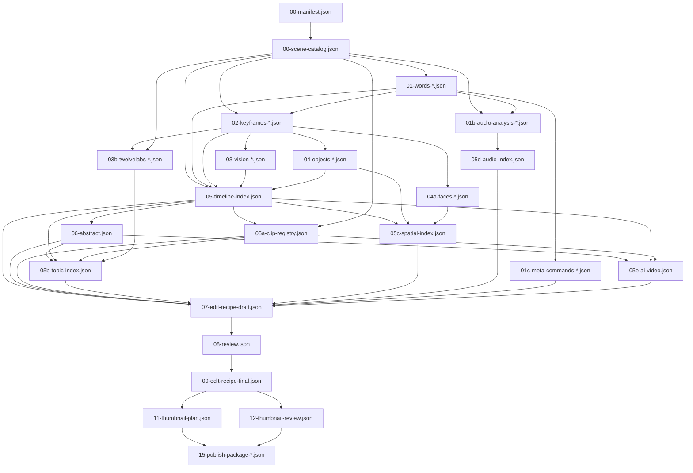

# Pipeline — analiza, reżyseria i montaż

Dokument opisuje **jak działa** system od surowych klipów do gotowego MP4 i **dlaczego** jest zbudowany w ten sposób.

Powiązane: [`README.md`](../README.md), [`docs/CONTEXT.md`](CONTEXT.md) — pola `batchContext`, schematy JSON w `schemas/json/`, kod w `src/`.

---

## Idea architektury

System rozdziela trzy fazy, które mają różne koszty i częstotliwość zmian:

| Faza | Wejście | Wyjście | Dlaczego osobno |
|------|---------|---------|-----------------|
| **Analiza** | pliki w `inbox/` | indeksy JSON (słowa, sceny, audio, wizja) | drogie (GPU, API); wyniki są cache'owane i współdzielone między batchami |
| **Reżyseria** | indeksy + kontekst użytkownika | `09-edit-recipe-final.json` | decyzje montażowe w JSON — można walidować, poprawiać i renderować wielokrotnie |
| **Render** | receptura + artefakty batcha | MP4 w `renders/` | deterministyczny FFmpeg — bez kosztów GPT |

Receptura montażowa (`EditRecipe`) to **plan deklaratywny**: segmenty timeline, B-roll, techniki kreatywne, miks audio. Renderer tylko go wykonuje — nie „zgaduje" montażu.

```
inbox/*.MOV
    → analiza (18 kroków) → indeksy + abstrakcja
    → director (+ enrichery) → 07-edit-recipe-draft.json
    → critic/fixer loop → 09-edit-recipe-final.json
    → thumbnails + publish (opcjonalnie)
    → render (FFmpeg) → renders/*.mp4
```

---

## Kroki pipeline

Orchestrator (`src/pipeline/orchestrator.js`) wykonuje kroki w kolejności z `PIPELINE_STEPS` (`src/pipeline/work-paths.js`):

```
ingest → transcribe → meta_commands → audio_analysis → keyframes → twelvelabs → vision → objects
  → index → clip_profile → abstract → topic_index → spatial_index → ai_video → direct → review
  → thumbnails → publish
```

Kroki `thumbnails` i `publish` są w `PIPELINE_STEPS`, ale można je pominąć (`--to-step review`). `ai_video` uruchamia się tylko gdy `batchContext.aiVideoEnabled === true` (CLI: `--ai-video`).

### Meta-komendy (`meta_commands`)

Krok deterministyczny po transkrypcji — wykrywa instrukcje montażowe w mowie (`src/editorial/meta-commands.js`, krok `src/pipeline/steps/meta-commands.js`):

| Typ | Wyzwalacz (PL) | Efekt w enricherze |
|-----|----------------|-------------------|
| `add_text_overlay` | „dodaj [tu] datę/napis…” | `textOverlays` + cięcie instrukcji z audio |
| `boomerang` | „zrob [tu] boomerang” | `videoTransform.playbackMode: boomerang` |
| `reverse` | „cofnij” / „odpalcie to wstecz” | `videoTransform.playbackMode: reverse` |

- Wejście: `01-words-<clipId>.json`, `00-scene-catalog.json`
- Wyjście: `01c-meta-commands-<clipId>.json`
- Enricher `enrichRecipeVoiceDirectives` materializuje komendy na timeline (cięcia `voice_directive`, overlaye, playback)
- Brief directora zawiera `constraints.voiceDirectivePolicy: "enricher_materializes"` — **nie** dodawaj w szkicu GPT `cuts[]`, `textOverlays` ani `playbackMode` dla meta-komend; enricher robi to deterministycznie z `01c-*`

```bash
# Tylko meta-komendy na gotowym batchu
node src/cli.js run --batch-id <id> --from-step meta_commands --to-step meta_commands --force
```


### AI video hooks (`ai_video`)

Opt-in krok generujący krótki hook (Kling VIDEO 3.0, model `kling-v3`) dla shortów `9:16` — max 1 klip/batch, domyślnie 5 s, `audio: false`.

- Włączenie: `--ai-video` lub `"aiVideoEnabled": true` w `--context`
- Stub (bez API): `--ai-video-stub` sam włącza krok; `AI_VIDEO_STUB=1` wybiera stub dla kroku włączonego kontekstem lub `--ai-video`. Brak kluczy live kończy krok błędem zamiast cichego użycia placeholdera.
- Klucze: `KLING_ACCESS_KEY` + `KLING_SECRET_KEY` ([kling.ai/dev/pricing](https://kling.ai/dev/pricing))
- Po sukcesie live wygenerowany plik przechodzi przez istniejącą analizę TwelveLabs. Wynik i status trafiają do `05e-ai-video.json`; awaria analizy nie usuwa hooka.
- Director dostaje wygenerowaną scenę, prompt, pochodzenie klatek, stan audio i realną interpretację TwelveLabs. Może dobrać muzykę/przejście albo pominąć słaby hook. `enrichRecipeAiHook` jest tylko idempotentnym fallbackiem.
- Artefakt: `05e-ai-video.json`; klip rejestrowany w manifeście jako `ai_generated`
- Enricher `enrichRecipeAiHook` wstawia segment `ai_hook` na początku shorta

```bash
npm run full -- --input inbox/ --ai-video --ai-video-stub --context '{"requiredFormats":["9:16"]}'
# alias: npm run pipeline
```

### Publish (pakiet publikacji)

Krok `publish` (`src/pipeline/steps/publish.js`) zbiera metadane do wrzucenia na platformę — jeden plik `15-publish-package-<outputId>.json` na wyjście:

- tytuł z receptury + warianty z planu miniatur,
- opis (synopsis + znaczniki rozdziałów `M:SS Tytuł`),
- tagi z `05b-topic-index.json` i TwelveLabs,
- ścieżki miniatury i wideo z planu miniatur / `13-render-manifest.json`.

`chapterMarkers` w recepturze są uzupełniane przez enricher rozdziałów (`chapter-hints.js`) lub wyliczane w kroku publish z timeline / L2.

```bash
npm run full -- --from-step publish --to-step publish --batch-id <id>
```

---

Każdy krok czyta artefakty upstream i zapisuje swoje. Graf mtime + hash treści źródła decyduje, czy krok można pominąć (cache). Pełny graf: `src/pipeline/artifact-deps.js`.



### Tabela kroków

| # | Krok | Wejścia | Wyjścia | Technologia / rola |
|---|------|---------|---------|-------------------|
| 1 | `ingest` | folder `--input` | `00-manifest.json`, `00-scene-catalog.json` | FFmpeg + detekcja scen (Python); hash SHA-256 per klip |
| 2 | `transcribe` | scene catalog, manifest (`expectedTerms`, `profanityPolicy`) | `01-words-<clipId>.json` | OpenAI Whisper; loudnorm -18 LUFS; filler + profanity tagging |
| 3 | `meta_commands` | words, scene catalog | `01c-meta-commands-<clipId>.json` | reguły PL: overlay, boomerang, reverse |
| 4 | `audio_analysis` | catalog, words | `01b-audio-analysis-<clipId>.json`, `05d-audio-index.json` | librosa (beaty, energia, cisza) lub fallback `ffmpeg_astats` |
| 5 | `keyframes` | catalog, words | `02-keyframes-<clipId>.json` | hybrydowy sampling + FFmpeg |
| 6 | `twelvelabs` | catalog, manifest | `03b-twelvelabs-<clipId>.json` | TwelveLabs API (rozdziały, momenty) lub stub |
| 7 | `vision` | keyframes | `03-vision-<clipId>.json` | Qwen2.5-VL (mlx-vlm) |
| 8 | `objects` | keyframes | `04-objects-<clipId>.json` | Florence-2 |
| 9 | `index` | catalog, words, keyframes, vision, objects | `05-timeline-index.json` | agregacja czasowa batcha; wzbogaca scene catalog (`hasSpeech`, `wordRange`) |
| 10 | `clip_profile` | timeline, catalog | `05a-clip-registry.json` | role klipów (A-roll, B-roll pool, outtakes, narration) |
| 11 | `abstract` | timeline | `06-abstract.json`, `06-abstract-L1/L2/L3.json` | GPT summarizer — hierarchia L1 → L2 → L3 |
| 12 | `topic_index` | abstraction, timeline, clip registry, twelvelabs | `05b-topic-index.json` | embeddingi OpenAI + keyword — dopasowanie tematów mowy do scen B-roll |
| 13 | `spatial_index` | timeline, objects | `05c-spatial-index.json`, `04a-faces-<clipId>.json` | face detect (OpenCV) + kotwice przestrzenne |
| 14 | `ai_video` | abstraction, timeline, clip registry (`aiVideoEnabled`) | `05e-ai-video.json`, `03b-twelvelabs-ai_hook_01.json` | Kling API (`kling-v3`) + analiza wygenerowanego hooka (opcjonalnie; jawny stub: lavfi) |
| 15 | `direct` | indeksy + abstraction + meta_commands + ai_video | `05f-music-selection.json`, `07-edit-recipe-draft.json`, `14-recipe-provenance.json` (częściowo) | **music curator** (nano) → GPT director (+ enrichery deterministyczne) |
| 16 | `review` | draft + indeksy | `08-review.json`, `09-edit-recipe-final.json` | critic/fixer loop (GPT + walidatory Zod) |
| 17 | `thumbnails` | final recipe, indeksy | `11-thumbnail-plan.json`, `12-thumbnail-review.json`, `thumbnails/<outputId>/*.png` | GPT strategist + critic; render PNG (Sharp) |
| 18 | `publish` | final recipe, thumbnail plan, indeksy | `15-publish-package-<outputId>.json` | metadane publikacji (tytuł, opis, tagi, rozdziały) |

### Dlaczego ta kolejność

- **Transkrypcja przed meta_commands i audio/keyframes** — słowa z Whispera kierują meta-komendy, sampling klatek i analizę ciszy.
- **Meta_commands przed direct** — enricher `voiceDirectives` potrzebuje artefaktów `01c-*` przed recepturą.
- **Keyframes przed vision/objects/face** — modele wizyjne pracują na reprezentatywnych klatkach, nie na całym wideo.
- **Index przed abstract** — summarizer dostaje gotowy `sceneMap` z transkryptem, wizją i detekcjami.
- **Abstract przed topic_index i ai_video** — tematy B-roll i hook planner korzystają z L1/L2/L3.
- **Spatial_index przed direct** — director i `creativeMoments` potrzebują kotwic (twarz, subject, bbox) do zoomów i reframe 9:16.
- **Ai_video przed direct** — Director widzi rzeczywisty hook i analizę TwelveLabs; enricher wstawia go tylko gdy Director go nie użył.
- **Music curator przed direct** — nano wybiera `trackId` z shortlisty katalogu (`05f-music-selection.json`); reżyser dostaje `musicSelection` + `musicBeatGrid`, nie cały katalog.
- **Direct przed review** — GPT planuje montaż; deterministyczne walidatory i critic łapią błędy strukturalne.
- **Thumbnails po review** — plan miniatur z finalnej receptury; publish konsumuje plan + review.

---

## Artefakty

Wszystkie pliki w `output/.work/<batchId>/`:

| Plik | Krok | Zawartość |
|------|------|-----------|
| `00-manifest.json` | ingest | metadane batcha, `contentHash` per klip, `artifactMtimes` |
| `00-scene-catalog.json` | ingest | granice scen per klip |
| `01-words-<clipId>.json` | transcribe | WordIndex (Whisper) — `isFiller`, `isProfanity`, `displayWord` |
| `01c-meta-commands-<clipId>.json` | meta_commands | voice directives wykryte w transkrypcie |
| `01b-audio-analysis-<clipId>.json` | audio_analysis | energia, beaty, cisza, tagi audio (PANNs) |
| `02-keyframes-<clipId>.json` | keyframes | ścieżki klatek kluczowych |
| `03b-twelvelabs-<clipId>.json` | twelvelabs | rozdziały, momenty, podsumowanie klipu |
| `03-vision-<clipId>.json` | vision | opisy Qwen per klatka |
| `04-objects-<clipId>.json` | objects | detekcje Florence-2 |
| `04a-faces-<clipId>.json` | spatial_index | bbox twarzy |
| `05-timeline-index.json` | index | TimelineIndex — sceny, słowa, wizja, detekcje |
| `05a-clip-registry.json` | clip_profile | role klipów |
| `05b-topic-index.json` | topic_index | tematy mowy → sceny B-roll |
| `05c-spatial-index.json` | spatial_index | kotwice przestrzenne |
| `05d-audio-index.json` | audio_analysis | LUFS, beaty, cisza, `deadAirHints`, rekomendacja muzyki |
| `05e-ai-video.json` | ai_video | plan hooka Kling + ścieżka wygenerowanego klipu |
| `06-abstract-L*.json` | abstract | abstrakcje L1/L2/L3 |
| `07-edit-recipe-draft.json` | direct | receptura montażowa (draft) |
| `08-review.json` | review | wynik critic/fixer |
| `09-edit-recipe-final.json` | review | finalna receptura po walidacji |
| `10-batch-quality-report.json` | report (CLI) | metryki jakości batcha |
| `11-thumbnail-plan.json` | thumbnails | warianty miniatur per output (GPT lub stub) |
| `12-thumbnail-review.json` | thumbnails | ocena krytyka miniatur |
| `14-recipe-provenance.json` | direct + review | audyt receptury: snapshoty po directorze/enricherach/review, log enricherów, `stitchValidation`, `superCriticReview` |
| `16-gpt-usage.json` | review | zużycie tokenów GPT per krok pipeline |
| `13-render-manifest.json` | render | manifest montażu |
| `15-publish-package-<outputId>.json` | publish | pakiet publikacji (tytuł, opis, tagi, rozdziały) |
| `renders/*.mp4` | render | wyeksportowane wideo |

---

## Warstwy danych → brief directora

Director (`buildDirectorBrief` w `src/agents/director.js`) nie widzi surowych plików — dostaje skondensowany JSON:

| Artefakt | Co trafia do briefu |
|----------|---------------------|
| `05-timeline-index.json` | `sceneMap`, `fillerStats`, `transcriptExcerpts` (słowa A-roll z timerami) |
| `06-abstract.json` | `sessionSummary` (L3), `segmentSummaries` (L2), pola L1 w `sceneMap` |
| `05a-clip-registry.json` | `clipRegistry`, `excludedHints` |
| `05b-topic-index.json` | `topicIndex` — dopasowanie tematów do B-roll |
| `05c-spatial-index.json` | `spatialIndex`, `spatialRefExamples` |
| `05d-audio-index.json` | `audioIndex` (beaty, `deadAirHints`, cutSuggestions), `audioMixDefaults` |
| `01c-meta-commands-*.json` | nie w briefie GPT — tylko enricher `enrichRecipeVoiceDirectives`; director dostaje `voiceDirectivePolicy: enricher_materializes` |
| `03b-twelvelabs-*.json` | `twelveLabsMoments` — skondensowane rozdziały i momenty per klip |
| `techniques/` | `techniqueCatalog` — dozwolone zabiegi i budżet |
| `--context` | `batchContext`, `creativityProfile`, `shortsRetentionProfile` |

**Dlaczego brief, a nie surowe artefakty:** limity kontekstu GPT i koszt tokenów. Brief zawiera tylko to, co wpływa na decyzje montażowe.

### Voice directives, TwelveLabs i meta-komendy

Trzy warstwy „instrukcji z materiału”:

| Źródło | Kiedy | Co robi director / enrichery |
|--------|-------|------------------------------|
| **Meta-komendy** (`01c-*`) | mówione instrukcje montażu w A-roll | Brief: `voiceDirectivePolicy: enricher_materializes` — director **nie** dodaje cutów/overlayów w szkicu; `enrichRecipeVoiceDirectives` materializuje cięcia, overlaye, boomerang/reverse |
| **twelveLabsMoments** | TwelveLabs API / stub | skrót rozdziałów i highlightów w briefie directora (`buildTwelveLabsBriefFields`) |
| **voiceDirectives** (receptura) | wynik enrichera | `cuts[]` z `reason: voice_directive`, `textOverlays`, `videoTransform.playbackMode` |

Przepływ meta-komend: `transcribe` → `meta_commands` (detekcja) → `direct` (GPT bez materializacji komend) → `enrichRecipeVoiceDirectives` (timeline).

---

## Transkrypcja

Krok `transcribe` (`src/pipeline/steps/transcribe.js`, `src/lib/transcribe.js`):

1. **Ekstrakcja audio** — loudnorm -18 LUFS; chunking przy plikach > 24 MB.
2. **Whisper** — prompt bazowy + `expectedTerms` z `batchContext` (nazwy własne, gry, seriale).
3. **Filler tagging** — `tagFillerWords()` oznacza `isFiller` (ehm, yyy, …) w `WordIndex`.
4. **Profanity tagging** — `tagProfanityWords()` + lista `config/profanity-pl.json`; `displayWord` cenzurowany wg `profanitySubtitleMode` (`partial` \| `full`).
5. **Korekta expectedTerms** — `applyExpectedTermCorrections()` naprawia typowe błędy Whispera na znanych frazach (np. nazwy gier).
6. **Fingerprint cache** — zmiana `expectedTerms` unieważnia cache `01-words-*` (globalny i per-batch).

### profanityPolicy

| Wartość | Transcribe | Enricher `enrichRecipeProfanity` |
|---------|----------|----------------------------------|
| `bleep` (domyślnie) | tag + `displayWord` | `audioCensorship` z `mode: bleep` |
| `mute` | j.w. | `audioCensorship` z `mode: mute` |
| `cut` | tag | `cuts[]` z `reason: profanity` |
| `off` | bez tagowania | enricher pomijany |

```bash
node src/cli.js run --input ./inbox/day --context '{"profanityPolicy":"mute","expectedTerms":["Breaking Bad"]}'
```

### Whisper benchmark

Audyt jakości transkrypcji na fixture'ach (`fixtures/whisper-audit/` — opis struktury: [`fixtures/whisper-audit/README.md`](../fixtures/whisper-audit/README.md)):

```bash
npm run benchmark:whisper              # tryb live (wymaga OPENAI_API_KEY)
npm run benchmark:whisper:fixture      # replay zapisanych odpowiedzi Whisper (bez API)
node scripts/whisper-benchmark.js --case profanity-literal --json
```

Kod: `src/lib/whisper-benchmark.js`, kontrakt: `tests/contracts/whisper-audit-contract.test.js`.

---

## Reżyseria: director, Super Director, enrichery

### Ścieżka klasyczna (krótkie batchy)

Gdy łączny czas materiału **≤ 600 s** i jest **jeden segment L2**, krok `direct` wywołuje pojedynczego directora (`runDirector` + opcjonalny drill-down).

### Super Director (długie batchy)

Gdy czas **> 600 s** lub **> 1 segment L2** (`shouldUseSuperDirector()` w `src/lib/segment-catalog.js`), chyba że `batchContext.forceClassicDirector === true` — wtedy zawsze ścieżka klasyczna (jeden director + opcjonalny drill-down).

1. **Super Director** (`prompts/v2/super-director.md`) — wybiera max `batchContext.superDirectorMaxSegments` segmentów L2 (domyślnie **10**, fallback stała `SUPER_DIRECTOR_MAX_SEGMENT_PICKS`), planuje narrację między nimi.
2. **Segment Director** — częściowe receptury per segment L2 (równolegle, `SEGMENT_DIRECTOR_CONCURRENCY`).
3. **Merge** (`src/lib/recipe-merge.js`) — skleja w `07-edit-recipe-draft.json`.
4. Opcjonalny **drill-down** (jak ścieżka klasyczna) — drugi pass directora na wybrane sceny.
5. **Stitch validation** + **repair** — `validateStitchContinuity()`; przy błędach `repairStitchContinuity()` (`src/lib/stitch-repair.js`) i ponowna walidacja.
6. **Super Critic** — ocena spójności cross-segment **po** stitch validate/repair, przed enricherami i krokiem `review`.

**Dlaczego:** jeden prompt directora na 30+ min materiału przekracza sensowny kontekst i jakość spada. Segmentacja L2 od summarizera daje naturalne granice narracyjne.

### Director drill-down (`shouldRunDirectorDrillDown`)

Po pierwszym passie directora (ścieżka klasyczna, nie Super Director) orchestrator może uruchomić **drugi pass GPT** z drill-down na wybrane sceny (`directorDrillDown` w `src/agents/director.js`).

Warunki uruchomienia (`shouldRunDirectorDrillDown`):

| Warunek | Efekt |
|---------|--------|
| `batchContext.skipDrillDown === true` | **pomija** drill-down |
| meta-komendy w batchu (`metaCommandsByClip` z co najmniej jedną komendą) | **uruchamia** |
| `timelineIndex.stats.fillerWordCount >= 5` | **uruchamia** |
| łącznie `deadAirHints` w `audioIndex.clips[]` ≥ 2 | **uruchamia** |
| ≤ 3 sceny w recepturze | **pomija** |
| cross-clip B-roll (`audioRef.clipId ≠ videoRef.clipId`) | **uruchamia** |
| jakiekolwiek `cuts[]` w timeline | **uruchamia** |
| > 12 scen | **uruchamia** |
| inaczej | **pomija** |

```bash
node src/cli.js direct --batch-id <id> --context '{"skipDrillDown":true}'
```

### Enrichery deterministyczne (po directorze)

Po GPT (direct lub merge) pipeline uruchamia reguły bez LLM (`buildDeterministicEnricherSteps` w `src/pipeline/steps/agents.js`):

| # | Enricher | Co robi |
|---|----------|---------|
| 1 | `stripEnrichBeatsInSlowSegments` | usuwa beaty enrich w wolnych segmentach L2 |
| 2 | `enrichRecipeColdOpenSegment` | cold open z hintów L3 |
| 3 | `enrichRecipeAiHook` | segment `ai_hook` z `05e-ai-video.json` |
| 4 | `enrichRecipeFillerCuts` | wycinanie słów-fillerów |
| 5 | `enrichRecipeProfanity` | bleep/mute/cut wg `profanityPolicy` |
| 6 | `enrichRecipeVoiceDirectives` | meta-komendy → cuts, overlaye, playback |
| 7 | `enrichRecipeDeadAirHandling` | cięcia ciszy z `deadAirHints` |
| 8 | `enrichRecipePacingTrim` | dopasowanie tempa do `estimatedKeepRatio` |
| 9 | `enrichRecipeFastRhythmSpeed` | przyspieszenie w segmentach szybkiego rytmu |
| 10 | `enrichRecipeJlCutSnap` | snap J/L-cut do granic słów |
| 11 | `enrichRecipeSfxPlan` | plan SFX z tagów audio (śmiech, impact) |
| 12 | `enrichRecipeRetentionBeats` | beaty retencji dla shortów |
| 13 | `enrichRecipePayoffMoments` | payoff narracyjne |
| 14 | `enrichRecipeCallbackMoments` | callbacki narracyjne |
| 15 | `enrichRecipeClosureCta` | CTA zamknięcia |
| 16 | `enrichRecipeChapterCards` | karty rozdziałów |
| 17 | `enrichRecipeActTransitions` | przejścia między aktami |
| 18 | `enrichBrollSyncFromHints` | synchronizacja B-roll (pomijane przy `brollStrategy: minimal`) |
| 19 | `enrichJumpCutsAsTimeCuts` | jump cuty jako time cuts w segmencie |

**Dlaczego enrichery osobno od GPT:** powtarzalne reguły (snap do słowa, cięcie fillera, profanity, voice directives) są tańsze i bardziej precyzyjne deterministycznie niż w promptcie directora.

Każdy enricher jest logowany w `14-recipe-provenance.json` (delta segmentów, cutów, creativeMoments, sfxPlan). Pola `stitchValidation` i `superCriticReview` trafiają do provenance, nie do `09-edit-recipe-final.json`.

Ponowne uruchomienie enricherów bez GPT:

```bash
node src/cli.js enrich --batch-id <id> --source draft --target final --force
```

Komenda `enrich` ładuje artefakt `05e-ai-video.json` (gdy istnieje) przez `loadAiVideoArtifact()` — enricher `enrichRecipeAiHook` może wstawić segment hooka bez ponownego wywołania Kling.

---

## Komendy CLI (skrót)

| Komenda | Domyślny zakres | Opis |
|---------|-----------------|------|
| `analyze` | `ingest` → `clip_profile` | analiza wstępna (indeksy, clip registry) — **bez** abstract/direct |
| `direct` | `abstract` → `review` | reżyseria na gotowym batchu (wymaga `--batch-id`) |
| `full` / `pipeline` | pełny `PIPELINE_STEPS` | analiza + reżyseria + review + miniatury + publish |
| `enrich` | — | ponowny pass enricherów deterministycznych (ładuje m.in. `05e-ai-video.json`) |

```bash
npm run analyze -- --input ./inbox/day          # kończy na clip_profile
npm run direct -- --batch-id <id>               # od abstract
npm run full -- --input ./inbox/day             # alias: npm run pipeline
```

---

## Pętla review (critic / fixer)

Krok `review` iteruje do `maxReviewIterations` (domyślnie 3):

1. **Critic** — heurystyki deterministyczne (Zod, scene registry, kody walidacji) + ocena jakościowa GPT; na ścieżce Super Director uwzględnia `superCriticReview` z poprzedniego passa.
2. **Fixer** — naprawia błędy `severity: error` w recepturze.
3. Na ścieżce **Super Director** — po każdym fixerze pipeline ponownie uruchamia **Super Critic** (krok `super_critic` w `16-gpt-usage.json`), aktualizując `superCriticReview` i `crossSegmentNotes` przed kolejną iteracją critic/fixer.
4. Po zatwierdzeniu — zapis `09-edit-recipe-final.json`.

Wyjście critic: `08-review.json` (`ReviewResult` — `approved`, `issues[]`, `summary`).

**`--strict-review`:** gdy ustawione, pipeline nie zapisuje `09-edit-recipe-final.json` bez `approved: true` od krytyka (błąd `RECIPE_REVIEW_NOT_APPROVED`), nawet jeśli walidacja Zod przechodzi. Domyślnie final może powstać z `needsHumanReview: true`.

**Dlaczego pętla:** director może naruszyć reguły (B-roll bez audio match, reuse sceny, brak hooka w shortcie). Critic łączy twarde reguły z oceną narracyjną; fixer koryguje bez pełnego re-run analizy.

---

## EditRecipe — receptura montażowa

Schemat: `src/schemas/edit-recipe-v2.js`, eksport: `schemas/json/EditRecipeV2.schema.json`.

### Korzeń receptury

| Pole | Rola |
|------|------|
| `batchId` | Identyfikator batcha |
| `batchContext` | tryb wejścia, formaty, strategia B-roll, shorty |
| `clipRegistry[]` | role plików: `aroll_primary`, `broll_pool`, `outtakes`, `narration_track` |
| `outputs[]` | jeden element = jeden docelowy render (16:9 main, 9:16 short, …) |
| `excluded[]` | `whole_clip` / `scene` / `time_range` |
| `creativityProfile` | poziom montażu (`safe` / `balanced` / `bold` / `shorts`), pack technik |
| `creativeMoments[]` | zabiegi z katalogu `techniques/` (zoom, przejścia, overlay) — **osobna warstwa od segmentów** |
| `shortsRetentionProfile` | gramatyka hooków i beatów dla `outputKind: "short"` |
| `audioMixPlan` | LUFS, muzyka bed, ducking — plan; wykonanie w rendererze |
| `sfxPlan[]` | plan efektów dźwiękowych |
| `colorGrade` | LUT + exposure/contrast/saturation |
| `renderStylePresets` | fonty, kolory, safe zones napisów i overlayów |

### Segment timeline (`outputs[].timeline[]`)

Każdy segment to jeden kawałek składanki z rozdzielonymi referencjami wideo i audio:

```json
{
  "segmentId": "seg_012",
  "segmentRole": "aroll",
  "videoRef": { "clipId": "clip03", "sceneId": "clip03_scene002" },
  "audioRef": { "clipId": "clip01", "sceneId": "clip01_scene008" },
  "videoInSec": 12.0,
  "videoOutSec": 18.0,
  "audioInSec": 45.0,
  "audioOutSec": 51.0,
  "audioPolicy": "from_audio_ref",
  "cuts": [{ "startWordId": "clip01_w0042", "endWordId": "clip01_w0048", "reason": "filler" }],
  "videoTransform": { "speed": 1, "speedMode": "video_audio", "fitMode": "pillarbox" },
  "sourceVolumeDb": -3
}
```

**Reguły kanoniczne:**

- `MediaRef` = tylko `{ clipId, sceneId }` — czasy zawsze na segmencie.
- Cross-clip B-roll: `audioRef.clipId ≠ videoRef.clipId`, `audioPolicy: "from_audio_ref"`.
- `cuts[].wordIds` muszą należeć do transkryptu `audioRef.clipId`.
- Napisy i overlaye: czasy względem **timeline outputu**.

### Creative moments

Osobna tablica technik montażowych zsynchronizowana z osią outputu:

```json
{
  "momentId": "cm_hook_zoom",
  "techniqueId": "zoom_punch_in",
  "outputId": "short_9x16",
  "outputStartSec": 0.5,
  "outputEndSec": 2.5,
  "spatialRef": { "clipId": "clip01", "sceneId": "clip01_scene001", "anchorType": "face", "bbox": [0.1, 0.2, 0.5, 0.6] },
  "retentionRole": "hook"
}
```

Katalog: `techniques/catalog.meta.json` + JSON per technika. Domyślny pack vlog: `youtube_vlog_2026`.

### Voice-over i narracja

Do `inbox/` można dodać plik `.mp3` / `.wav` / `.m4a` obok wideo. Ingest ustawia `mediaType: audio_only`, `clipRole: narration_track`. W jednym outputcie mogą współistnieć segmenty `from_video_ref` (A-roll) i `from_audio_ref` (B-roll wizualny + audio narracji). Fixture: `fixtures/batches/voiceover-day/`.

### Pionowe wstawki w main 16:9

Krótkie klipy 9:16 jako segmenty `broll` (2–15 s). Renderer domyślnie robi **pillarbox**. W recepturze: `videoTransform.fitMode: "pillarbox"` lub `"fill"`.

---

## Context DSL

Tekst wolny trafia do `batchContext.notes`. Tokeny parsowane regexem:

| Token | Efekt |
|-------|--------|
| `creativity: safe` \| `balanced` \| `bold` \| `shorts` | `creativityProfile.level` |
| `shorts: energy high` | pack `shorts_energy`, gęstość montażu |
| `shorts: retention` | włącza `shortsRetentionProfile`, pack `shorts_retention_2026` |

Gdy `--context` zaczyna się od `{`, parsowany jest jako JSON i merge'owany z `batchContext`.

Pełna lista pól JSON (domyślne, typy): [`docs/CONTEXT.md`](CONTEXT.md).

### Wybrane pola `batchContext`

| Pole | Domyślnie | Rola |
|------|-----------|------|
| `inputMode` | auto | `single_clip` / `multi_clip_day` |
| `requiredFormats` | `["16:9", "9:16"]` z CLI | docelowe formaty renderu |
| `brollStrategy` | `match_speech_topics` | strategia B-roll |
| `brollMatchThreshold` | `0.55` | próg dopasowania topic → scena |
| `shortsMaxDurationSec` | `60` | limit długości shorta |
| `qualityOverQuantity` | `true` | walidator — mniej scen, wyższa jakość |
| `profanityPolicy` | `bleep` | `bleep` \| `mute` \| `cut` \| `off` |
| `expectedTerms` | `[]` | nazwy własne dla Whisper + korekta |
| `skipDrillDown` | `false` | wyłącza drugi pass directora |
| `forceClassicDirector` | `false` | wymusza klasycznego directora zamiast Super Director |
| `superDirectorDurationThresholdSec` | `600` | próg czasu (s) — powyżej włącza Super Director |
| `superDirectorMaxSegments` | `10` | max segmentów L2 w Super Director (fallback: `SUPER_DIRECTOR_MAX_SEGMENT_PICKS`) |
| `aiVideoEnabled` | `false` | krok `ai_video` (CLI `--ai-video` nadpisuje) |
| `publishVoice` | loud thumbnails, lowercase opisy | ton miniatur i publish |

Retention shortów **włącza się** przy domyślnym `16:9,9:16` (dual format) — wymaga outputu `outputKind: "short"`, jawnego `shorts: retention`, lub `creativity: shorts`.

---

## Cache i invalidacja

### Graf mtime (per batch)

`src/pipeline/artifact-deps.js` — krok pomijany, gdy artefakt istnieje i upstream nie jest nowszy. `--force` wymusza przebudowę.

### Hash treści (`contentHash`)

Ingest zapisuje SHA-256 per klip w manifeście. Per-clip artefakty trzymają `sourceContentHash`. Podmiana pliku wideo bez `--force` unieważnia cache nawet przy starym `mtime`.

Dodatkowe warunki stale (`src/lib/clip-artifact-cache.js`):

- starsza wersja schematu artefaktu,
- przejście TwelveLabs stub → live (przy niezmienionym pliku odświeżane są tylko insights API, bez re-uploadu).

### Globalny cache analizy (cross-batch)

Drogie kroki per-clip mogą odczytać wynik z `output/.cache/analysis/<step>/<cacheKey>.json`, gdy ten sam `contentHash`, `PIPELINE_ANALYSIS_VERSION` i fingerprint konfiguracji.

| Wyłączenie | Sposób |
|------------|--------|
| CLI | `--no-global-cache` |
| `.env` | `DISABLE_GLOBAL_ANALYSIS_CACHE=1` |

Podbij `PIPELINE_ANALYSIS_VERSION` (`src/lib/pipeline-analysis-version.js`) po zmianie logiki analizy lub modeli.

**Nie cache'owane globalnie:** abstract, direct, review, timeline-index (zależą od kontekstu batcha).

### Stale spatial index

Gdy `05-timeline-index.json` lub `04-objects-*.json` są nowsze niż `05c-spatial-index.json`, spatial index jest automatycznie przebudowywany (również przy `--from-step direct` przez `ensureSpatialIndex`).

---

## Miniatury (`thumbnails`)

Krok po `review` (`src/pipeline/steps/thumbnails.js`):

1. **Shortlist klatek** — `shortlistThumbnailFrames` z timeline, spatial index, audio.
2. **Strategist** (GPT) lub **stub** — `11-thumbnail-plan.json` z wariantami per output (`headline`, `style`, `sourceRef`).
3. **Critic** (GPT) lub stub — `12-thumbnail-review.json`.
4. **Render PNG** — `thumbnails/<outputId>/<variantId>.png` (Sharp + FFmpeg extract frame).

Wymaga `09-edit-recipe-final.json`. `publishVoice` z `batchContext` formatuje nagłówki wariantów.

| Flaga CLI | Efekt |
|-----------|--------|
| `--thumbnail-stub` | deterministyczny plan + auto-approved review, bez GPT i bez PNG |
| `--no-thumbnail-render` | plan + critic GPT, bez renderu PNG |

```bash
node src/cli.js run --batch-id <id> --from-step thumbnails --to-step thumbnails
node src/cli.js run --batch-id <id> --thumbnail-stub --from-step thumbnails
```

---

## Render (FFmpeg)

Osobna komenda po wygenerowaniu `09-edit-recipe-final.json`:

```bash
npm run render -- --batch-id <id>
npm run render -- --batch-id <id> --output-id horizontal_main --encode-profile draft
npm run render -- --batch-id <id> --from-pass creative --keep-tmp
```

### Passy renderu

1. **Segment** — każdy segment timeline → `renders/.tmp/<outputId>/seg_NNN.mp4`
2. **Concat** — `concat.mp4` (xfade + acrossfade gdy możliwe)
3. **Creative** — `creativeMoments` (zoom, ken burns, …)
4. **Subtitles** — ASS burn-in
5. **Graphics** — `textOverlays`
6. **Audio mix** — `audioMixPlan` + `sfxPlan` + ducking
7. **Color grade** — LUT / eq
8. Export → `renders/<outputId>_<format>.mp4`
9. Manifest → `13-render-manifest.json`

Kod: `src/render/execute-render.js`, kontekst: `resolve-render-context.js`, EDL: `build-render-edl.js`.

**Dlaczego multi-pass:** każdy pass ma inne wymagania FFmpeg (trim vs concat vs overlay vs miks). Resume (`--from-pass`) pozwala wznowić po błędzie bez re-renderu segmentów.

### Obsługiwane możliwości receptury

| Obszar | Status |
|--------|--------|
| A-roll / B-roll cross-clip | ✅ |
| `from_video_ref` / `from_audio_ref` (VO) | ✅ |
| `cuts[]` na word timestamps | ✅ |
| `videoTransform.speed` + `speedMode` | ✅ |
| `sourceVolumeDb` | ✅ |
| 9:16 reframe + spatial anchor | ✅ |
| `creativeMoments` (zoom, crossfade, whip pan, …) | ✅ |
| `textOverlays` | ✅ |
| `audioMixPlan` (muzyka bed, ducking, LUFS) | ✅ |
| `sfxPlan` | ✅ |
| `colorGrade` + LUT | ✅ |
| J/L-cut (`overlapSec`, `acrossfade` + video trim/tpad) | ✅ |
| Partial crossfade (3+ segmentów) | ✅ |
| Render fidelity (V27) | walidacja przed FFmpeg; `--allow-render-warnings` |

Techniki mają pole `renderSupport` w `techniques/*.json` (`full` | `partial` | `stub` | `audio_only` | `graphics_only` | `segment_only`). Walidator: `src/validators/render-fidelity.js`.

---

## Provenance receptury

Po kroku `direct` i `review` pipeline zapisuje `14-recipe-provenance.json`:

- snapshoty po directorze, enricherach i review (hash + liczniki)
- `enricherLog[]` — który enricher co dodał/zmienił
- `directorMetrics` — `directorPath` (`classic` \| `super`), `drillDownRan`, `drillDownSceneCount`, `briefSceneMapCoverage` (ułamek scen z draftu objętych drill-down; 0–1), **`briefMetrics`** (dashboard rozmiaru briefów GPT: `calls[]` per task, `totals.jsonBytes` / `totals.estimatedTokens`)
- `diffs` — director→enriched, enriched→final
- `stitchValidation`, `superCriticReview` (super-path) — nie trafiają do final recipe

### Zużycie tokenów GPT

Po kroku `review` pipeline zapisuje `16-gpt-usage.json` — suma tokenów per krok (`abstract`, `direct`, `drill_down`, `super_director`, `segment_director`, `super_critic`, `critic`, `fixer`).

### Diagnostyka batcha

```bash
node src/cli.js doctor --batch-id <id>
```

Sprawdza: obecność artefaktów, stale cache (graf `artifact-deps`), `needsHumanReview`, provenance super-path, `16-gpt-usage.json`. Exit code `1` przy problemach krytycznych.

---

## Parallelizacja analizy

Zmienne środowiskowe (`.env`):

| Zmienna | Domyślnie | Opis |
|---------|-----------|------|
| `CLIP_CONCURRENCY` | 2 | równoległe klipy (transcribe, audio, keyframes, twelvelabs) |
| `GPU_CONCURRENCY` | 1 | vision, objects, face detect |
| `SEGMENT_DIRECTOR_CONCURRENCY` | 3 | równoległe wywołania segment directora (Super Director) |

Orchestrator używa wave scheduling (`src/pipeline/analysis-phase.js`):

```
Wave A: transcribe ∥ audio_analysis ∥ twelvelabs (per klip)
Wave B: keyframes
Wave C: vision ∥ objects
```

---

## Raport jakości batcha

```bash
node src/cli.js report --batch-id <id>
node src/cli.js report --batch-id <id> --quality-profile production
```

Zapisuje `10-batch-quality-report.json`.

### Bramki (`qualityGateFailures`)

| Profil | Bramki |
|--------|--------|
| `lenient` (domyślny) | anchor ≥50%, topic match ≥50%, L1 ≥80%, brak błędów walidacji |
| `production` | + stub coverage 0%, V27 errors = 0, face anchor ≥30%, review approved, `super_critic_not_approved` (super-path), `brief_scene_map_coverage_low` (ścieżka klasyczna: `briefSceneMapCoverage` &lt; 0.5 przy &gt;30 scenach) |
| `shorts` | production + retention beats + hook w 3s |

Dodatkowe metryki: `stubCoverage`, `enricherContribution`, `renderFidelityWarningCount`, `narrativeValidatorBreakdown`, `reviewIterations`.

---

## Tryby live vs stub

Domyślnie vision, face, audio i objects są **live** (pełna analiza Python). Stuby tylko jawne flagami (`--vision-stub`, `--face-stub`, `--audio-stub`, `--objects-stub`) — głównie testy CI.

**Profile analizy** (`--analysis-profile`):

| Profil | Stuby | Global cache |
|--------|-------|--------------|
| `preview` | vision, face, audio, objects, twelvelabs | włączony |
| `production` | brak (live) | włączony |
| `ci` | jak preview | wyłączony (`--no-global-cache`) |

Jawne flagi CLI (`--vision-stub`, `--vision-live`, …) nadpisują profil.

| Krok | Domyślnie | Stub |
|------|-----------|------|
| Vision (Qwen2.5-VL) | live | `--vision-stub` |
| Face detect | live | `--face-stub` |
| Audio analysis | live | `--audio-stub` |
| Objects (Florence-2) | live | `--objects-stub` lub `--no-objects` |
| TwelveLabs | live (gdy `TWELVELABS_API_KEY`) | `--twelvelabs-stub` |

---

## Pliki źródłowe

| Obszar | Ścieżka |
|--------|---------|
| Orchestrator | `src/pipeline/orchestrator.js` |
| Kroki | `src/pipeline/steps/*.js` |
| Graf zależności + cache | `src/pipeline/artifact-deps.js`, `src/lib/clip-artifact-cache.js`, `src/lib/global-analysis-cache.js` |
| Agenci | `src/agents/director.js`, `super-director.js`, `segment-director.js`, `critic.js`, `fixer.js`, `super-critic.js` |
| Enrichery | `src/editorial/*.js` |
| Walidatory | `src/validators/*.js` |
| Render | `src/render/*.js` |
| Schematy | `src/schemas/`, `schemas/json/` |
| Prompty | `prompts/v2/` (kanoniczne); `prompts/v1/` — legacy |
| Techniki | `techniques/` |
| SFX (testowe stuby) | `assets/sfx/catalog.json` — produkcyjne pliki wymagają własnych licencji (`assets/sfx/LICENSES.md`) |
