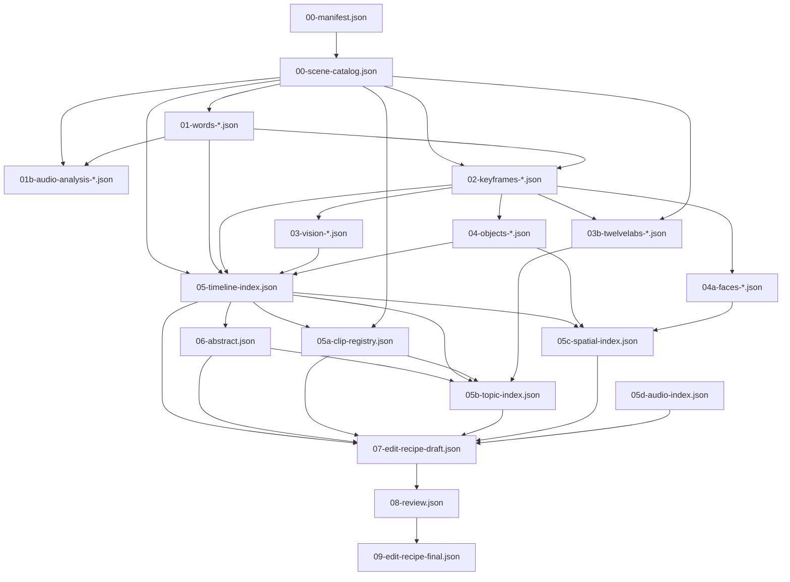

# Pipeline — analiza, reżyseria i montaż

Dokument opisuje **jak działa** system od surowych klipów do gotowego MP4 i **dlaczego** jest zbudowany w ten sposób.

Powiązane: [`README.md`](../README.md), schematy JSON w `schemas/json/`, kod w `src/`.

---

## Idea architektury

System rozdziela trzy fazy, które mają różne koszty i częstotliwość zmian:

| Faza | Wejście | Wyjście | Dlaczego osobno |
|------|---------|---------|-----------------|
| **Analiza** | pliki w `inbox/` | indeksy JSON (słowa, sceny, audio, wizja) | drogie (GPU, API); wyniki są cache'owane i współdzielone między batchami |
| **Reżyseria** | indeksy + kontekst użytkownika | `09-edit-recipe-final.json` | decyzje montażowe w JSON — można walidować, poprawiać i renderować wielokrotnie |
| **Render** | receptura + artefakty batcha | MP4 w `renders/` | deterministyczny FFmpeg — bez kosztów GPT |

Receptura montażowa (`EditRecipe`) to **plan deklaratywny**: segmenty timeline, B-roll, techniki kreatywne, miks audio. Renderer tylko go wykonuje — nie „zgaduje" montażu.

```
inbox/*.MOV
    → analiza (14 kroków) → indeksy + abstrakcja
    → director (+ enrichery) → 07-edit-recipe-draft.json
    → critic/fixer loop → 09-edit-recipe-final.json
    → render (FFmpeg) → renders/*.mp4
```

---

## Kroki pipeline

Orchestrator (`src/pipeline/orchestrator.js`) wykonuje kroki w kolejności z `PIPELINE_STEPS` (`src/pipeline/work-paths.js`):

```
ingest → transcribe → audio_analysis → keyframes → twelvelabs → vision → objects
  → index → clip_profile → abstract → topic_index → spatial_index → direct → review
```

Opcjonalnie poza główną ścieżką: `thumbnails`.

### Graf zależności artefaktów

Każdy krok czyta artefakty upstream i zapisuje swoje. Graf mtime + hash treści źródła decyduje, czy krok można pominąć (cache). Pełny graf: `src/pipeline/artifact-deps.js`.



### Tabela kroków

| # | Krok | Wejścia | Wyjścia | Technologia / rola |
|---|------|---------|---------|-------------------|
| 1 | `ingest` | folder `--input` | `00-manifest.json`, `00-scene-catalog.json` | FFmpeg + detekcja scen (Python); hash SHA-256 per klip |
| 2 | `transcribe` | scene catalog | `01-words-<clipId>.json` | OpenAI Whisper; loudnorm -18 LUFS |
| 3 | `audio_analysis` | catalog, words | `01b-audio-analysis-<clipId>.json`, `05d-audio-index.json` | librosa (beaty, energia, cisza) lub fallback `ffmpeg_astats` |
| 4 | `keyframes` | catalog, words | `02-keyframes-<clipId>.json` | hybrydowy sampling + FFmpeg |
| 5 | `twelvelabs` | catalog, manifest | `03b-twelvelabs-<clipId>.json` | TwelveLabs API (rozdziały, momenty) lub stub |
| 6 | `vision` | keyframes | `03-vision-<clipId>.json` | Qwen2.5-VL (mlx-vlm) |
| 7 | `objects` | keyframes | `04-objects-<clipId>.json` | Florence-2 |
| 8 | `index` | catalog, words, keyframes, vision, objects | `05-timeline-index.json` | agregacja czasowa batcha; wzbogaca scene catalog (`hasSpeech`, `wordRange`) |
| 9 | `clip_profile` | timeline, catalog | `05a-clip-registry.json` | role klipów (A-roll, B-roll pool, outtakes) |
| 10 | `abstract` | timeline | `06-abstract.json`, `06-abstract-L1/L2/L3.json` | GPT summarizer — hierarchia L1 (sceny) → L2 (segmenty) → L3 (sesja) |
| 11 | `topic_index` | abstraction, timeline, clip registry, twelvelabs | `05b-topic-index.json` | embeddingi OpenAI + keyword — dopasowanie tematów mowy do scen B-roll |
| 12 | `spatial_index` | timeline, objects, faces | `05c-spatial-index.json`, `04a-faces-<clipId>.json` | face detect (OpenCV) + kotwice przestrzenne |
| 13 | `direct` | indeksy + abstraction | `07-edit-recipe-draft.json` | GPT director (+ enrichery deterministyczne) |
| 14 | `review` | draft + indeksy | `08-review.json`, `09-edit-recipe-final.json` | critic/fixer loop (GPT + walidatory Zod) |

### Dlaczego ta kolejność

- **Transkrypcja przed audio/keyframes** — słowa z Whispera kierują sampling klatek i analizę ciszy między słowami.
- **Keyframes przed vision/objects/face** — modele wizyjne pracują na reprezentatywnych klatkach, nie na całym wideo.
- **Index przed abstract** — summarizer dostaje gotowy `sceneMap` z transkryptem, wizją i detekcjami.
- **Abstract przed topic_index** — tematy B-roll korzystają z L1/L2 i momentów TwelveLabs.
- **Spatial_index przed direct** — director i `creativeMoments` potrzebują kotwic (twarz, subject, bbox) do zoomów i reframe 9:16.
- **Direct przed review** — GPT planuje montaż; deterministyczne walidatory i critic łapią błędy strukturalne.

---

## Artefakty

Wszystkie pliki w `output/.work/<batchId>/`:

| Plik | Krok | Zawartość |
|------|------|-----------|
| `00-manifest.json` | ingest | metadane batcha, `contentHash` per klip, `artifactMtimes` |
| `00-scene-catalog.json` | ingest | granice scen per klip |
| `01-words-<clipId>.json` | transcribe | WordIndex (Whisper) |
| `01b-audio-analysis-<clipId>.json` | audio_analysis | energia, beaty, cisza, tagi audio (PANNs) |
| `02-keyframes-<clipId>.json` | keyframes | ścieżki klatek kluczowych |
| `03b-twelvelabs-<clipId>.json` | twelvelabs | rozdziały, momenty, podsumowanie klipu |
| `03-vision-<clipId>.json` | vision | opisy Qwen per klatka |
| `04-objects-<clipId>.json` | objects | detekcje Florence-2 |
| `04a-faces-<clipId>.json` | spatial_index | bbox twarzy |
| `05-timeline-index.json` | index | TimelineIndex — sceny, słowa, wizja, detekcje |
| `05a-clip-registry.json` | clip_profile | role klipów |
| `05b-topic-index.json` | topic_index | tematy mowy → sceny B-roll |
| `05c-spatial-index.json` | spatial_index | kotwice przestrzenne |
| `05d-audio-index.json` | audio_analysis | LUFS, beaty, cisza, `deadAirHints`, rekomendacja muzyki |
| `06-abstract-L*.json` | abstract | abstrakcje L1/L2/L3 |
| `07-edit-recipe-draft.json` | direct | receptura montażowa (draft) |
| `08-review.json` | review | wynik critic/fixer |
| `09-edit-recipe-final.json` | review | finalna receptura po walidacji |
| `10-batch-quality-report.json` | report (CLI) | metryki jakości batcha |
| `14-recipe-provenance.json` | direct + review | audyt receptury: snapshoty po directorze/enricherach/review, log enricherów, `stitchValidation`, `superCriticReview` |
| `13-render-manifest.json` | render | manifest montażu |
| `renders/*.mp4` | render | wyeksportowane wideo |

---

## Warstwy danych → brief directora

Director (`buildDirectorBrief` w `src/agents/director.js`) nie widzi surowych plików — dostaje skondensowany JSON:

| Artefakt | Co trafia do briefu |
|----------|---------------------|
| `05-timeline-index.json` | `sceneMap`, `fillerStats`, `transcriptExcerpts` (słowa A-roll z timerami) |
| `06-abstract.json` | `sessionSummary` (L3), `segmentSummaries` (L2), pola L1 w `sceneMap` |
| `05a-clip-registry.json` | `clipRegistry`, `excludedHints` |
| `05b-topic-index.json` | `topicIndex` — dopasowanie tematów do B-roll |
| `05c-spatial-index.json` | `spatialIndex`, `spatialRefExamples` |
| `05d-audio-index.json` | `audioIndex` (beaty, `deadAirHints`, cutSuggestions), `audioMixDefaults` |
| `techniques/` | `techniqueCatalog` — dozwolone zabiegi i budżet |
| `--context` | `batchContext`, `creativityProfile`, `shortsRetentionProfile` |

**Dlaczego brief, a nie surowe artefakty:** limity kontekstu GPT i koszt tokenów. Brief zawiera tylko to, co wpływa na decyzje montażowe.

---

## Reżyseria: director, Super Director, enrichery

### Ścieżka klasyczna (krótkie batchy)

Gdy łączny czas materiału **≤ 600 s** i jest **jeden segment L2**, krok `direct` wywołuje pojedynczego directora (`runDirector` + opcjonalny drill-down).

### Super Director (długie batchy)

Gdy czas **> 600 s** lub **> 1 segment L2** (`shouldUseSuperDirector()` w `src/lib/segment-catalog.js`):

1. **Super Director** (`prompts/v2/super-director.md`) — wybiera max 10 segmentów L2, planuje narrację między nimi.
2. **Segment Director** — częściowe receptury per segment L2.
3. **Merge** (`src/lib/recipe-merge.js`) — skleja w `07-edit-recipe-draft.json`.
4. **Stitch validation** — `validateStitchContinuity()` sprawdza ciągłość między segmentami.
5. **Super Critic** — ocena spójności cross-segment przed review.

**Dlaczego:** jeden prompt directora na 30+ min materiału przekracza sensowny kontekst i jakość spada. Segmentacja L2 od summarizera daje naturalne granice narracyjne.

### Enrichery deterministyczne (po directorze)

Po GPT (direct lub merge) pipeline uruchamia reguły bez LLM (`applyDeterministicRecipeEnrichers` w `src/pipeline/steps/agents.js`):

| Enricher | Co robi |
|----------|---------|
| `enrichRecipeSfxPlan` | plan SFX z tagów audio (śmiech, impact) |
| `enrichRecipeDeadAirHandling` | cięcia ciszy z `deadAirHints` |
| `enrichRecipeFillerCuts` | wycinanie słów-fillerów |
| `enrichRecipePacingTrim` | dopasowanie tempa do `estimatedKeepRatio` |
| `enrichRecipeFastRhythmSpeed` | przyspieszenie w segmentach szybkiego rytmu |
| `enrichRecipeJlCutSnap` | snap J/L-cut do granic słów |
| `enrichRecipeRetentionBeats` | beaty retencji dla shortów |
| `enrichRecipePayoffMoments` / `enrichRecipeCallbackMoments` | payoff i callbacki narracyjne |
| `enrichRecipeChapterCards` / `enrichRecipeColdOpenSegment` | karty rozdziałów, cold open |
| `enrichBrollSyncFromHints` | synchronizacja B-roll z keyframes + L1 |
| `enrichJumpCutsAsTimeCuts` | jump cuty jako time cuts w segmencie |

**Dlaczego enrichery osobno od GPT:** powtarzalne reguły (snap do słowa, cięcie fillera) są tańsze i bardziej precyzyjne deterministycznie niż w promptcie directora.

Każdy enricher jest logowany w `14-recipe-provenance.json` (delta segmentów, cutów, creativeMoments, sfxPlan). Pola `stitchValidation` i `superCriticReview` trafiają do provenance, nie do `09-edit-recipe-final.json`.

Ponowne uruchomienie enricherów bez GPT:

```bash
node src/cli.js enrich --batch-id <id> --source draft --target final --force
```

---

## Pętla review (critic / fixer)

Krok `review` iteruje do `maxReviewIterations` (domyślnie 3):

1. **Critic** — heurystyki deterministyczne (Zod, scene registry, kody walidacji) + ocena jakościowa GPT.
2. **Fixer** — naprawia błędy `severity: error` w recepturze.
3. Po zatwierdzeniu — zapis `09-edit-recipe-final.json`.

Wyjście critic: `08-review.json` (`ReviewResult` — `approved`, `issues[]`, `summary`).

**Dlaczego pętla:** director może naruszyć reguły (B-roll bez audio match, reuse sceny, brak hooka w shortcie). Critic łączy twarde reguły z oceną narracyjną; fixer koryguje bez pełnego re-run analizy.

---

## EditRecipe — receptura montażowa

Schemat: `src/schemas/edit-recipe-v2.js`, eksport: `schemas/json/EditRecipeV2.schema.json`.

### Korzeń receptury

| Pole | Rola |
|------|------|
| `batchId` | Identyfikator batcha |
| `batchContext` | tryb wejścia, formaty, strategia B-roll, shorty |
| `clipRegistry[]` | role plików: `aroll_primary`, `broll_pool`, `outtakes`, `narration_track` |
| `outputs[]` | jeden element = jeden docelowy render (16:9 main, 9:16 short, …) |
| `excluded[]` | `whole_clip` / `scene` / `time_range` |
| `creativityProfile` | poziom montażu (`safe` / `balanced` / `bold` / `shorts`), pack technik |
| `creativeMoments[]` | zabiegi z katalogu `techniques/` (zoom, przejścia, overlay) — **osobna warstwa od segmentów** |
| `shortsRetentionProfile` | gramatyka hooków i beatów dla `outputKind: "short"` |
| `audioMixPlan` | LUFS, muzyka bed, ducking — plan; wykonanie w rendererze |
| `sfxPlan[]` | plan efektów dźwiękowych |
| `colorGrade` | LUT + exposure/contrast/saturation |
| `renderStylePresets` | fonty, kolory, safe zones napisów i overlayów |

### Segment timeline (`outputs[].timeline[]`)

Każdy segment to jeden kawałek składanki z rozdzielonymi referencjami wideo i audio:

```json
{
  "segmentId": "seg_012",
  "segmentRole": "aroll",
  "videoRef": { "clipId": "clip03", "sceneId": "clip03_scene002" },
  "audioRef": { "clipId": "clip01", "sceneId": "clip01_scene008" },
  "videoInSec": 12.0,
  "videoOutSec": 18.0,
  "audioInSec": 45.0,
  "audioOutSec": 51.0,
  "audioPolicy": "from_audio_ref",
  "cuts": [{ "startWordId": "clip01_w0042", "endWordId": "clip01_w0048", "reason": "filler" }],
  "videoTransform": { "speed": 1, "speedMode": "video_audio", "fitMode": "pillarbox" },
  "sourceVolumeDb": -3
}
```

**Reguły kanoniczne:**

- `MediaRef` = tylko `{ clipId, sceneId }` — czasy zawsze na segmencie.
- Cross-clip B-roll: `audioRef.clipId ≠ videoRef.clipId`, `audioPolicy: "from_audio_ref"`.
- `cuts[].wordIds` muszą należeć do transkryptu `audioRef.clipId`.
- Napisy i overlaye: czasy względem **timeline outputu**.

### Creative moments

Osobna tablica technik montażowych zsynchronizowana z osią outputu:

```json
{
  "momentId": "cm_hook_zoom",
  "techniqueId": "zoom_punch_in",
  "outputId": "short_9x16",
  "outputStartSec": 0.5,
  "outputEndSec": 2.5,
  "spatialRef": { "clipId": "clip01", "sceneId": "clip01_scene001", "anchorType": "face", "bbox": [0.1, 0.2, 0.5, 0.6] },
  "retentionRole": "hook"
}
```

Katalog: `techniques/catalog.meta.json` + JSON per technika. Domyślny pack vlog: `youtube_vlog_2026`.

### Voice-over i narracja

Do `inbox/` można dodać plik `.mp3` / `.wav` / `.m4a` obok wideo. Ingest ustawia `mediaType: audio_only`, `clipRole: narration_track`. W jednym outputcie mogą współistnieć segmenty `from_video_ref` (A-roll) i `from_audio_ref` (B-roll wizualny + audio narracji). Fixture: `fixtures/batches/voiceover-day/`.

### Pionowe wstawki w main 16:9

Krótkie klipy 9:16 jako segmenty `broll` (2–15 s). Renderer domyślnie robi **pillarbox**. W recepturze: `videoTransform.fitMode: "pillarbox"` lub `"fill"`.

---

## Context DSL

Tekst wolny trafia do `batchContext.notes`. Tokeny parsowane regexem:

| Token | Efekt |
|-------|--------|
| `creativity: safe` \| `balanced` \| `bold` \| `shorts` | `creativityProfile.level` |
| `shorts: energy high` | pack `shorts_energy`, gęstość montażu |
| `shorts: retention` | włącza `shortsRetentionProfile`, pack `shorts_retention_2026` |

Gdy `--context` zaczyna się od `{`, parsowany jest jako JSON i merge'owany z `batchContext`.

### Pola `batchContext` (domyślne z orchestratora)

| Pole | Domyślnie |
|------|-----------|
| `inputMode` | auto: 1 klip → `single_clip`, 2+ → `multi_clip_day` |
| `requiredFormats` | `["16:9", "9:16"]` z CLI |
| `brollStrategy` | `match_speech_topics` |
| `brollMatchThreshold` | `0.55` |
| `shortsMaxDurationSec` | `60` |
| `qualityOverQuantity` | `true` |

Retention shortów **nie włącza się** przy domyślnym `16:9,9:16` — wymaga jawnego `shorts: retention`, `creativity: shorts`, lub outputu `outputKind: "short"`.

---

## Cache i invalidacja

### Graf mtime (per batch)

`src/pipeline/artifact-deps.js` — krok pomijany, gdy artefakt istnieje i upstream nie jest nowszy. `--force` wymusza przebudowę.

### Hash treści (`contentHash`)

Ingest zapisuje SHA-256 per klip w manifeście. Per-clip artefakty trzymają `sourceContentHash`. Podmiana pliku wideo bez `--force` unieważnia cache nawet przy starym `mtime`.

Dodatkowe warunki stale (`src/lib/clip-artifact-cache.js`):

- starsza wersja schematu artefaktu,
- przejście TwelveLabs stub → live (przy niezmienionym pliku odświeżane są tylko insights API, bez re-uploadu).

### Globalny cache analizy (cross-batch)

Drogie kroki per-clip mogą odczytać wynik z `output/.cache/analysis/<step>/<cacheKey>.json`, gdy ten sam `contentHash`, `PIPELINE_ANALYSIS_VERSION` i fingerprint konfiguracji.

| Wyłączenie | Sposób |
|------------|--------|
| CLI | `--no-global-cache` |
| `.env` | `DISABLE_GLOBAL_ANALYSIS_CACHE=1` |

Podbij `PIPELINE_ANALYSIS_VERSION` (`src/lib/pipeline-analysis-version.js`) po zmianie logiki analizy lub modeli.

**Nie cache'owane globalnie:** abstract, direct, review, timeline-index (zależą od kontekstu batcha).

### Stale spatial index

Gdy `05-timeline-index.json` lub `04-objects-*.json` są nowsze niż `05c-spatial-index.json`, spatial index jest automatycznie przebudowywany (również przy `--from-step direct` przez `ensureSpatialIndex`).

---

## Render (FFmpeg)

Osobna komenda po wygenerowaniu `09-edit-recipe-final.json`:

```bash
npm run render -- --batch-id <id>
npm run render -- --batch-id <id> --output-id horizontal_main --encode-profile draft
npm run render -- --batch-id <id> --from-pass creative --keep-tmp
```

### Passy renderu

1. **Segment** — każdy segment timeline → `renders/.tmp/<outputId>/seg_NNN.mp4`
2. **Concat** — `concat.mp4` (xfade + acrossfade gdy możliwe)
3. **Creative** — `creativeMoments` (zoom, ken burns, …)
4. **Subtitles** — ASS burn-in
5. **Graphics** — `textOverlays`
6. **Audio mix** — `audioMixPlan` + `sfxPlan` + ducking
7. **Color grade** — LUT / eq
8. Export → `renders/<outputId>_<format>.mp4`
9. Manifest → `13-render-manifest.json`

Kod: `src/render/execute-render.js`, kontekst: `resolve-render-context.js`, EDL: `build-render-edl.js`.

**Dlaczego multi-pass:** każdy pass ma inne wymagania FFmpeg (trim vs concat vs overlay vs miks). Resume (`--from-pass`) pozwala wznowić po błędzie bez re-renderu segmentów.

### Obsługiwane możliwości receptury

| Obszar | Status |
|--------|--------|
| A-roll / B-roll cross-clip | ✅ |
| `from_video_ref` / `from_audio_ref` (VO) | ✅ |
| `cuts[]` na word timestamps | ✅ |
| `videoTransform.speed` + `speedMode` | ✅ |
| `sourceVolumeDb` | ✅ |
| 9:16 reframe + spatial anchor | ✅ |
| `creativeMoments` (zoom, crossfade, whip pan, …) | ✅ |
| `textOverlays` | ✅ |
| `audioMixPlan` (muzyka bed, ducking, LUFS) | ✅ |
| `sfxPlan` | ✅ |
| `colorGrade` + LUT | ✅ |
| J/L-cut (`overlapSec`, `acrossfade`) | ✅ częściowo |

---

## Raport jakości batcha

```bash
node src/cli.js report --batch-id <id>
```

Zapisuje `10-batch-quality-report.json`. Bramki jakości (`qualityGateFailures`):

| Kod | Znaczenie |
|-----|-----------|
| `anchor_coverage_below_50` | < 50% scen z kotwicami spatial |
| `topic_match_rate_below_50` | < 50% tematów z dopasowaniem B-roll |
| `l1_fields_present_below_80` | < 80% scen z `brollPotential` w L1 |
| `recipe_validation_errors` | błędy walidacji EditRecipe |

`needsHumanReview: true` gdy: niepusta `qualityGateFailures`, `recipe.needsHumanReview`, lub `08-review.json` z `approved: false`.

---

## Tryby live vs stub

Domyślnie vision, face, audio i objects są **live** (pełna analiza Python). Stuby tylko jawne flagami (`--vision-stub`, `--face-stub`, `--audio-stub`, `--objects-stub`) — głównie testy CI.

**Profile analizy** (`--analysis-profile`):

| Profil | Stuby | Global cache |
|--------|-------|--------------|
| `preview` | vision, face, audio, objects, twelvelabs | włączony |
| `production` | brak (live) | włączony |
| `ci` | jak preview | wyłączony (`--no-global-cache`) |

Jawne flagi CLI (`--vision-stub`, `--vision-live`, …) nadpisują profil.

| Krok | Domyślnie | Stub |
|------|-----------|------|
| Vision (Qwen2.5-VL) | live | `--vision-stub` |
| Face detect | live | `--face-stub` |
| Audio analysis | live | `--audio-stub` |
| Objects (Florence-2) | live | `--objects-stub` lub `--no-objects` |
| TwelveLabs | live (gdy `TWELVELABS_API_KEY`) | `--twelvelabs-stub` |

---

## Pliki źródłowe

| Obszar | Ścieżka |
|--------|---------|
| Orchestrator | `src/pipeline/orchestrator.js` |
| Kroki | `src/pipeline/steps/*.js` |
| Graf zależności + cache | `src/pipeline/artifact-deps.js`, `src/lib/clip-artifact-cache.js`, `src/lib/global-analysis-cache.js` |
| Agenci | `src/agents/director.js`, `super-director.js`, `segment-director.js`, `critic.js`, `fixer.js`, `super-critic.js` |
| Enrichery | `src/editorial/*.js` |
| Walidatory | `src/validators/*.js` |
| Render | `src/render/*.js` |
| Schematy | `src/schemas/`, `schemas/json/` |
| Prompty | `prompts/v2/` |
| Techniki | `techniques/` |
| SFX (testowe stuby) | `assets/sfx/catalog.json` — produkcyjne pliki wymagają własnych licencji (`assets/sfx/LICENSES.md`) |
