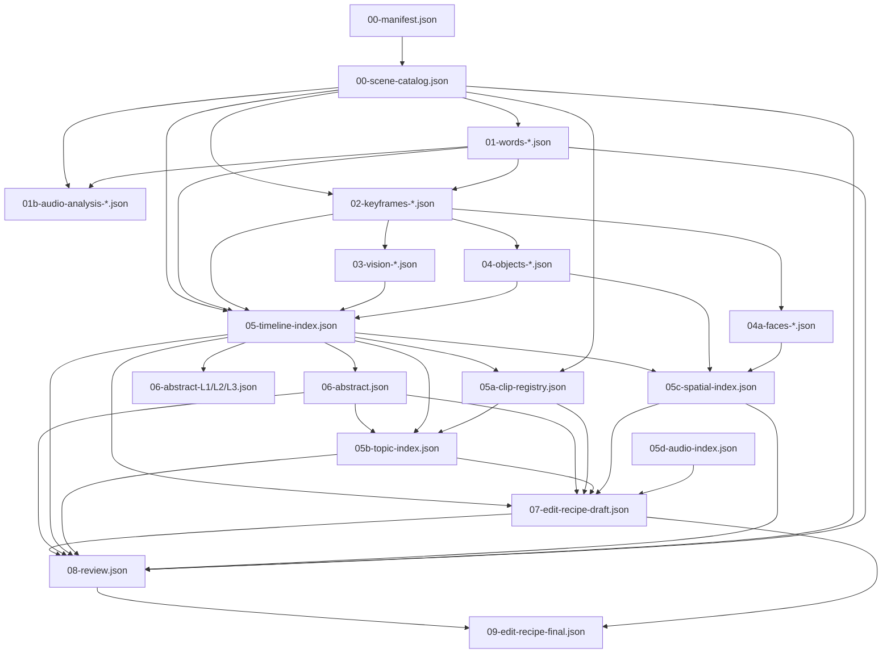

# Pre-render pipeline

> **Render MP4 jest osobnym krokiem.** Ten dokument opisuje analizę i reżyserię AI (kroki 1–12) — bez eksportu MP4 w tym etapie. Po wygenerowaniu `09-edit-recipe-final.json` uruchom `npm run render` / `node src/cli.js render`, aby wyprodukować pliki wideo (w tym miks audio wg `audioMixPlan`).

Pipeline analizy i reżyserii AI (**bez montażu wideo w krokach 1–12** — brak eksportu MP4 w pre-renderze). Artefakt końcowy pre-renderu: `09-edit-recipe-final.json`. Artefakty pośrednie zapisywane są w `output/.work/<batch-id>/`. Invalidacja cache opiera się na grafie zależności (`src/pipeline/artifact-deps.js`) — krok jest ponawiany, gdy którykolwiek plik wejściowy ma nowszy `mtime` niż artefakt wyjściowy.

**Domyślne tryby analizy:** vision, face i audio są **live** (pełny Python). Stuby: `--fast` lub jawne `--vision-stub`, `--face-stub`, `--audio-stub`. Objects (Florence-2) live domyślnie; `--fast` go nie wyłącza. Szczegółowa tabela: [README — Domyślne tryby](../README.md#domyślne-tryby-live-vs-stub).

## Graf zależności (mtime)



## Kroki pipeline (13)

| # | Krok CLI | Wejścia | Wyjścia | Uwagi |
|---|----------|---------|---------|-------|
| 1 | `ingest` | folder wideo (`--input`) | `00-manifest.json`, `00-scene-catalog.json` | opcjonalnie detekcja scen (Python) |
| 2 | `transcribe` | scene catalog | `01-words-<clipId>.json`, `audio/whisper/<clipId>.mp3` | Whisper / OpenAI, loudnorm -18 LUFS |
| 3 | `audio_analysis` | scene catalog, words | `01b-audio-analysis-<clipId>.json`, `05d-audio-index.json`, `audio/analysis/<clipId>.wav` | librosa beats/energy/silence; `--audio-stub` / `--fast` |
| 4 | `keyframes` | scene catalog, words | `02-keyframes-<clipId>.json` | hybrydowy sampling + FFmpeg |
| 5 | `vision` | keyframes | `03-vision-<clipId>.json` | Qwen2.5-VL (domyślnie **live**; `--vision-stub` / `--fast`) |
| 6 | `objects` | keyframes | `04-objects-<clipId>.json` | Florence-2 (opcjonalnie `--no-objects`) |
| 7 | `index` | catalog, words, keyframes, vision, objects | `05-timeline-index.json` (+ aktualizacja scene catalog) | indeks czasowy batcha |
| 8 | `clip_profile` | timeline index, scene catalog | `05a-clip-registry.json` | role klipów, jakość wizualna |
| 9 | `abstract` | timeline index | `06-abstract.json`, `06-abstract-L1/L2/L3.json` | summarizer (GPT) |
| 10 | `topic_index` | abstraction, timeline index, clip registry | `05b-topic-index.json` | tematy pod B-roll |
| 11 | `spatial_index` | timeline index, objects, faces (`04a-faces-*`) | `05c-spatial-index.json` | kotwice przestrzenne; face detect (domyślnie **live**; `--face-stub` / `--fast`) |
| 12 | `direct` | timeline, abstraction, clip registry, topic index, spatial index, **audio index** | `07-edit-recipe-draft.json` | director (GPT) + `audioMixPlan` defaults |
| 13 | `review` | recipe draft + indeksy | `08-review.json`, `09-edit-recipe-final.json` | critic/fixer loop |

Po kroku `review` orchestrator może wygenerować `10-batch-quality-report.json` (poza główną ścieżką pre-render).

### Face detect (sub-krok `spatial_index`)

Krok `spatial_index` uruchamia detekcję twarzy **przed** budową `05c-spatial-index.json`:

1. Dla każdego klipu czyta `02-keyframes-<clipId>.json` i wywołuje `python/face_detect.py`.
2. Zapisuje wynik per klip w `04a-faces-<clipId>.json` (bbox twarzy, `sceneId`, `timestampSec`).
3. Detekcje łączy z `objectDetections` z timeline index przy budowie kotwic przestrzennych.

Domyślnie używana jest detekcja **live** (OpenCV `face_detect.py` na keyframes). Stub (bez OpenCV, wystarczy do dev/E2E):

```bash
node src/cli.js run --input ./inbox/day-11 --face-stub
# lub szybki dev ze wszystkimi stubami vision/face/audio:
node src/cli.js run --input ./inbox/day-11 --fast
```

| Flaga | Efekt |
|-------|--------|
| *(domyślnie)* | `faceStub: false` — live OpenCV `face_detect.py` |
| `--face-stub` | `faceStub: true` — stub Haar cascade / brak OpenCV |
| `--fast` | `faceStub: true` (chyba że dodasz `--face-live`) |
| `--face-live` | `faceStub: false` — jawne wymuszenie live (przydatne z `--fast`) |

Logika w `src/cli.js`: `faceStub: args.faceStub === true || (args.fast === true && args.faceLive !== true)`.

Artefakt `04a-faces-*` jest zależny od `02-keyframes-*` w grafie mtime (`artifact-deps.js`). Przy wznowieniu od `direct` orchestrator woła `ensureSpatialIndex`, które odtwarza face detect gdy `05c` jest stale.

### Vision (krok `vision`)

Domyślnie **live** — lokalny Qwen2.5-VL przez `python/vision_qwen.py` (wymaga `mlx-vlm`). Stub: `--vision-stub` lub `--fast` (chyba że `--vision-live`). Logika: `visionStub: args.visionStub === true || (args.fast === true && args.visionLive !== true)`.

### Objects (krok `objects`)

Domyślnie **live** — Florence-2 (`python/vision_florence.py`). `--fast` **nie** wyłącza objects. Escape hatch: `--objects-stub` (dev) lub `--no-objects` (pomiń krok).

## Invalidacja cache

| Funkcja | Opis |
|---------|------|
| `isArtifactStale(workDir, name)` | `true` gdy brak pliku lub upstream ma nowszy `mtime` |
| `getStaleDownstream(changed)` | lista artefaktów zależnych (klucze grafu) |
| `shouldRebuildArtifact(workDir, name, force)` | `force \|\| isArtifactStale` |
| `shouldUseCachedArtifact(workDir, name, force)` | odwrotność — użyj cache |

Przykłady:

- **abstract** odświeża się, gdy `05-timeline-index.json` jest nowszy.
- **topic-index** odświeża się, gdy `06-abstract.json` (lub timeline / clip registry) jest nowszy.
- **recipe-draft** odświeża się, gdy `05c-spatial-index.json`, `05b-topic-index.json` lub abstraction są nowsze.
- **per-clip** — `02-keyframes-clip01.json` jest nieaktualny, gdy `01-words-clip01.json` jest nowszy.

Orchestrator zapisuje też `artifactMtimes` w `00-manifest.json` po każdym kroku (bez zmiany `mtime` manifestu), co ułatwia debugowanie bez kaskadowej invalidacji.

## Komendy CLI

```bash
# Pełny pipeline
node src/cli.js run --input ./inbox/day-11 --context "vlog dzień 66/100"

# Tylko analiza (ingest → index)
node src/cli.js analyze --input ./inbox/day-11

# Reżyseria na istniejącym batchu (abstract → review)
node src/cli.js direct --batch-id abc12345 --context "..."

# Wznowienie od wybranego kroku
node src/cli.js run --batch-id abc12345 --from-step topic_index
```

### Flagi istotne dla cache i trybu analizy

| Flaga | Efekt |
|-------|--------|
| `--force` | Wymusza przebudowę wszystkich kroków (ignoruje cache) |
| `--from-step` / `--to-step` | Ogranicza zakres kroków |
| `--no-keyframes` | Szybszy dry-run bez ekstrakcji klatek |
| `--no-objects` | Pomija detekcję obiektów |
| `--fast` | Stuby vision + face + audio (objects pozostaje live) |
| `--vision-stub` / `--vision-live` | Stub lub jawne live Qwen (domyślnie live) |
| `--face-stub` / `--face-live` | Stub lub jawne live face detect (domyślnie live) |
| `--audio-stub` | Stub analizy audio (domyślnie live librosa) |
| `--objects-stub` | Stub Florence-2 (domyślnie live) |

**Domyślnie bez flag:** vision, face i audio są **live**. Stuby włączają się tylko z `--fast` lub jawnymi `--*-stub`.

Bez `--force` każdy krok sprawdza `shouldUseCachedArtifact` przed pominięciem — samo istnienie pliku nie wystarczy, jeśli upstream się zmienił.

## Pliki źródłowe

| Obszar | Ścieżka |
|--------|---------|
| Graf zależności | `src/pipeline/artifact-deps.js` |
| Orchestrator | `src/pipeline/orchestrator.js` |
| Kroki | `src/pipeline/steps/*.js` |
| Nazwy artefaktów | `src/pipeline/work-paths.js` → `ARTIFACTS` |
| Schemat EditRecipe v2 | `src/schemas/edit-recipe-v2.js` |
| Parsowanie `--context` | `src/lib/input-mode.js`, `src/editorial/technique-budget.js`, `src/editorial/shorts-retention.js` |

## EditRecipe v2.3 — plan miksowania audio (pre-render)

Od v2.3 receptura może zawierać opcjonalne `audioMixPlan` — **plan** poziomów LUFS, muzyki bed i duckingu. Pipeline pre-render (kroki 1–12) **nie** wykonuje FFmpeg ani miksu; pole służy directorowi i walidatorowi. **Wykonanie miksu** odbywa się w rendererze (`src/render/audio-mix.js`, `npm run render`).

| Pole | Typ | Domyślnie | Opis |
|------|-----|-----------|------|
| `voiceTargetLufs` | number | `-16` | Docelowy poziom głosu na masterze |
| `preWhisperNormalizeLufs` | number | `-18` | Normalizacja wejścia przed Whisper |
| `musicBed` | object \| null | `null` | Zewnętrzna ścieżka muzyczna |
| `musicBed.trackId` | string | — | Identyfikator utworu (biblioteka, nie clipId) |
| `musicBed.volumeDb` | number | — | Poziom muzyki (dB) |
| `musicBed.duckingDb` | number | — | Ducking pod głos (dB) |
| `segments[]` | array | `[]` | Per-output timing muzyki |
| `segments[].outputId` | string | — | Powiązanie z `outputs[].outputId` |
| `segments[].musicInSec` | number? | — | Start muzyki na osi outputu |
| `segments[].musicOutSec` | number? | — | Koniec muzyki na osi outputu |
| `segments[].duckUnderVoice` | boolean | — | Czy ściemniać muzykę pod głosem |

Walidacja: **V23-01** (warning) — gdy `musicBed` jest ustawione, output powinien mieć segment z `audioPolicy: "external"`.

Receptury v2.0–v2.2 bez `audioMixPlan` pozostają w pełni ważne.

## batchContext — pola Zod (`BatchContextV2Schema`)

Ustawiane przez orchestrator z `--context` (tekst lub JSON) + domyślne wartości w `resolveBatchContext` (`src/pipeline/orchestrator.js`). W EditRecipe director zapisuje `batchContext` w `07-edit-recipe-draft.json`.

| Pole | Typ | Domyślnie | Przykład |
|------|-----|-----------|----------|
| `inputMode` | `"single_clip"` \| `"multi_clip_day"` \| `"multi_clip_collection"` | auto (1 klip → `single_clip`, 2+ → `multi_clip_day`) | `"multi_clip_day"` |
| `theme` | string? | — | `"vlog 100 dni"` |
| `dayLabel` | string? | — | `"dzień 66"` |
| `challengeDay` | string? | — | `"66/100"` |
| `targetPlatforms` | string[] | `[]` | `["youtube", "shorts"]` |
| `notes` | string? | tekst `--context` (gdy nie JSON) | `"montaż energiczny, bez outtakes"` |
| `qualityOverQuantity` | boolean | `true` | `true` |
| `allowWholeClipExclusion` | boolean | `true` | `true` |
| `brollStrategy` | `"match_speech_topics"` \| `"chronological"` \| `"director_choice"` \| `"minimal"` | `"match_speech_topics"` | `"match_speech_topics"` |
| `brollMatchThreshold` | number 0–1 | `0.55` | `0.6` |
| `allowBrollReuse` | boolean | `false` | `false` |
| `maxBrollSegmentsPerOutput` | int > 0 | `30` | `20` |
| `requiredFormats` | string[] (min 2) | `["16:9", "9:16"]` z CLI | `["9:16"]` |
| `minOutputs` | string[]? | — | deprecated — użyj `requiredFormats` |
| `shortsStrategy` | `"standalone_highlights"` | `"standalone_highlights"` | `"standalone_highlights"` |
| `shortsMaxDurationSec` | number > 0 | `60` | `45` |

### Składnia `--context` (tekst)

Tekst wolny trafia do `batchContext.notes` (oraz `userContext` w timeline). Dodatkowe tokeny parsowane są regexem w modułach editorial:

| Token / wzorzec | Moduł | Efekt |
|-----------------|-------|-------|
| `creativity: safe` \| `balanced` \| `bold` \| `shorts` | `technique-budget.js` | `creativityProfile.level` |
| `shorts: energy high` | `technique-budget.js` | `level: shorts`, pack `shorts_energy`, gęstość 0.6/min |
| `shorts: retention` | `shorts-retention.js` | włącza `shortsRetentionProfile`, pack `shorts_retention_2026` |
| `shorts: energy high` | `shorts-retention.js` | włącza retention (bez zmiany packa kreatywności) |
| Dowolny tekst (np. `vlog dzień 66`) | `input-mode.js` | `batchContext.notes` |

Tokeny można łączyć średnikiem lub przecinkiem w jednym stringu.

### Składnia `--context` (JSON)

Gdy `--context` zaczyna się od `{`, parsowany jest jako JSON i merge'owany z domyślnymi polami `batchContext` (nadpisuje pola Zod).

### Przykłady

```bash
# Tekst + token kreatywności
node src/cli.js run --input ./inbox/day-66 --context "vlog day 66; creativity: bold"

# Shorty z retencją i krótszym limitem
node src/cli.js direct --batch-id abc12345 --context 'shorts: retention; {"shortsMaxDurationSec":45}'

# Pełny JSON batchContext
node src/cli.js run --input ./inbox/day-11 --context '{"theme":"challenge 100","requiredFormats":["16:9","9:16"],"brollMatchThreshold":0.6,"targetPlatforms":["youtube"]}'
```

JSON w `--context` może ustawić dowolne pole z tabeli `batchContext` (oraz `creativityProfile` / `shortsRetentionProfile` jeśli director je propaguje z briefu).
