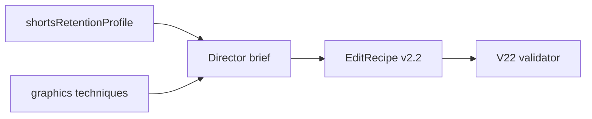

# EditRecipe v2.2 — Shorts Retention Grammar

> Status: plan do realizacji  
> Ostatnia aktualizacja: 2026-06-26  
> Zależności: EditRecipe v2.1 (creativity layer), render — przyszłość

## Problem i cel

Shorty i rolki wymagają **innej gramatyki montażu** niż długi vlog na YouTube:

1. **Hook 0–3 s** — najciekawszy moment, pytanie, twist (nie chronologia)
2. **Duży napis na start** — „NIE ZROBIŁBYŚ TEGO…”, liczba, pytanie
3. **Retention beat co 20–30 s** — zoom, cut, tekst, B-roll — coś co zatrzymuje scroll

v2.1 daje **tempo** (`shorts_energy`, 2× gęstość zabiegów), ale nie modeluje **struktury retencji** ani nie waliduje cadence.

**Cel:** warstwa `shortsRetentionProfile` + kategoria `graphics` w katalogu technik + walidatory V22 + prompt director/critic/fixer.

**Done looks like:**
- Nowe techniki `graphics/*` (hook, emphasis, pattern interrupt)
- Pack `shorts_retention_2026` (+ ewentualnie rozszerzenie `shorts_energy`)
- Schema v2.2: `shortsRetentionProfile`, rozszerzone `TextOverlayV2` (`style`, `role`)
- `retentionMoments[]` lub rozszerzenie `creativeMoments` z `retentionRole`
- Walidator V22-01…V22-06 (tylko `outputKind: "short"`)
- Director/critic/fixer prompty z sekcją retention grammar
- Testy jednostkowe + integracja z `validateRecipeV2`
- Appendix w spec + README

---

## Architektura

```
shortsRetentionProfile     →  reguły cadence (hook window, beat interval)
techniques/graphics/*      →  hook_title_overlay, pattern_interrupt, …
creativeMoments[]          →  retentionRole: hook | beat | payoff
textOverlays[]             →  style: hook_large | emphasis | chapter_card
validateShortsRetention()  →  V22-* tylko dla short outputs
```



---

## shortsRetentionProfile

```json
{
  "shortsRetentionProfile": {
    "enabled": true,
    "hookWindowSec": 3,
    "retentionBeatIntervalSec": 25,
    "retentionBeatToleranceSec": 5,
    "minRetentionBeats": 2,
    "requireHookMoment": true,
    "requireHookOverlay": true,
    "maxHookOverlayDurationSec": 4,
    "techniquePack": "shorts_retention_2026"
  }
}
```

Domyślnie włączone gdy:
- `outputKind: "short"` w którymkolwiek output, LUB
- `creativityProfile.level === "shorts"`, LUB
- `--context` zawiera `shorts: retention` lub `shorts: energy high`

Dla outputów `main` (16:9) profil jest ignorowany przez walidator.

---

## Nowe techniki — kategoria `graphics`

| id | Opis |
|----|------|
| `hook_title_overlay` | Duży napis 0–3 s na hook |
| `hook_visual_punch` | Najmocniejszy kadr/zoom w hook window |
| `emphasis_text` | Średni napis na punchline (3–5 s) |
| `chapter_card` | Krótka karta „Część 2” / licznik |
| `pattern_interrupt` | Pakiet: cut + zoom LUB tekst — reset uwagi |
| `retention_beat` | Meta-zabieg: dowolny zabieg oznaczony jako beat retencji |

Każda technika w `techniques/graphics/*.json` zgodna z `techniques/_schema.json` (rozszerzyć schema o kategorię `graphics` jeśli brak).

### Przykład: `hook_title_overlay.json`

```json
{
  "id": "hook_title_overlay",
  "category": "graphics",
  "platforms": ["shorts"],
  "constraints": {
    "maxDurationSec": 4,
    "requiresOutputKind": "short",
    "requiresCreativityLevel": "shorts",
    "mustOccurWithinOutputStartSec": 3
  },
  "params": {
    "style": { "type": "enum", "values": ["hook_large", "hook_question", "hook_number"], "default": "hook_large" },
    "position": { "type": "enum", "values": ["center", "top", "bottom_third"], "default": "center" }
  },
  "whenToUse": "Pierwsze 3 s shorta — obietnica wartości, pytanie, szok.",
  "syncHints": ["output_start"]
}
```

---

## Rozszerzenie TextOverlayV2

```json
{
  "text": "NIE UWIERZYSZ CO SIĘ STAŁO",
  "outputStartSec": 0,
  "outputEndSec": 2.5,
  "position": "center",
  "style": "hook_large",
  "role": "hook"
}
```

| Pole | Wartości |
|------|----------|
| `style` | `hook_large`, `hook_question`, `emphasis`, `chapter_card`, `subtitle_style` |
| `role` | `hook`, `retention_beat`, `payoff`, `cta` |

Walidator: `role: hook` tylko w `outputStartSec < hookWindowSec`.

---

## creativeMoments — retentionRole

Opcja A (preferowana): opcjonalne pole na `CreativeMomentSchema`:

```json
{
  "techniqueId": "pattern_interrupt",
  "retentionRole": "beat",
  "outputId": "short_9x16_01",
  "outputStartSec": 24,
  "outputEndSec": 26,
  "reason": "Reset uwagi przed reveal"
}
```

| retentionRole | Znaczenie |
|---------------|-----------|
| `hook` | Moment w hook window (0–3 s) |
| `beat` | Retention beat (cadence) |
| `payoff` | Kulminacja / odpowiedź na hook |
| null | Zwykły zabieg bez roli retencji |

---

## Pack: `shorts_retention_2026`

```json
{
  "id": "shorts_retention_2026",
  "enabledTechniqueIds": [
    "hook_title_overlay",
    "hook_visual_punch",
    "emphasis_text",
    "chapter_card",
    "pattern_interrupt",
    "retention_beat",
    "snap_zoom",
    "jump_cut",
    "hard_cut_energy",
    "cut_mid_sentence",
    "whip_pan",
    "reframe_follow_subject"
  ],
  "defaultCreativityLevel": "shorts",
  "retentionDefaults": {
    "hookWindowSec": 3,
    "retentionBeatIntervalSec": 25,
    "minRetentionBeats": 2
  }
}
```

Loader: `retentionDefaults` merge do `shortsRetentionProfile` gdy pack aktywny.

---

## Walidacja V22 (tylko short outputs)

| Kod | Reguła |
|-----|--------|
| V22-01 | Gdy `requireHookMoment`: w `[0, hookWindowSec]` jest moment z `retentionRole: hook` LUB `techniqueId` ∈ {hook_*, snap_zoom} na short output |
| V22-02 | Gdy `requireHookOverlay`: w hook window jest `textOverlays` z `role: hook` lub technika `hook_title_overlay` |
| V22-03 | `minRetentionBeats`: liczba momentów `retentionRole: beat` ≥ min (skalowane: 1 beat / 25 s dla filmu >30 s) |
| V22-04 | Cadence: max odstęp między beatami (lub dowolnym creativeMoment na short) ≤ `interval + tolerance` |
| V22-05 | `hook_title_overlay` / `role: hook` tylko w pierwszych `hookWindowSec` |
| V22-06 | Techniki `graphics` z `requiresOutputKind: short` tylko na outputach short |

Severity: V22-01, 02, 04 → error przy `level: shorts`; warning przy balanced short output.

---

## Integracja director

Brief dla short outputs zawiera:
- `shortsRetentionProfile` (merged z pack + batchContext)
- `retentionGrammarSummary` — skrócona lista reguł (hook, beats, overlays)
- Filtr katalogu: pack `shorts_retention_2026` gdy retention enabled

Sekcja w `prompts/v2/director.md`:
- 0–3 s: nie chronologia — najlepszy moment z L2/L3 abstract
- Hook tekstowy + wizualny
- Co 20–30 s: pattern interrupt
- Nie więcej niż 1 duży napis na 15 s (overlay budget)

`parseCreativityFromContext`: `shorts: retention` → włącza profile + pack.

---

## Pliki do utworzenia / zmiany

| Plik | Akcja |
|------|-------|
| `docs/SHORTS_RETENTION_V22_PLAN.md` | Ten plan |
| `techniques/graphics/*.json` | 6 technik |
| `techniques/packs/shorts_retention_2026.json` | Pack |
| `techniques/_schema.json` | Kategoria `graphics` |
| `techniques/catalog.meta.json` | Rejestr nowych plików |
| `src/schemas/edit-recipe-v2.js` | v2.2, ShortsRetentionProfile, TextOverlay rozszerzenie |
| `src/editorial/shorts-retention.js` | merge profile, compute beat targets, format for prompt |
| `src/validators/shorts-retention.js` | V22-01…06 |
| `src/validators/recipe-v2.js` | Hook V22 |
| `src/agents/director.js` | Brief injection |
| `src/agents/critic.js` | Heurystyka V22 |
| `src/agents/fixer.js` | V22 repair hints |
| `prompts/v2/director.md`, `critic.md`, `fixer.md` | Sekcje retention |
| `tests/editorial/shorts-retention*.test.js` | Testy |
| `docs/EDITING_RECIPE_V2_SPEC.md` | Appendix E |
| `README.md` | Sekcja v2.2 |

---

## Poza scope v2.2

- Render ffmpeg (style hook_large → font size)
- Auto-selekcja hook clip z abstract (LLM only w director)
- A/B testy retencji na platformach

---

## Test plan

```bash
npm test
```

- merge `shortsRetentionProfile` z pack defaults
- V22-01 fail: short bez hook w 0–3 s
- V22-04 fail: 45 s short, tylko 1 beat
- hook overlay poza window → V22-05
- main output ignoruje V22
- parse `shorts: retention` z context

---

## Kolejność implementacji

1. Rozszerz `_schema.json` + techniki graphics + pack
2. Schema Zod v2.2 + export JSON schema
3. `shorts-retention.js` editorial module
4. `validate-shorts-retention.js` + testy
5. Director/critic/fixer + prompty
6. README + spec appendix
7. Handoff update
